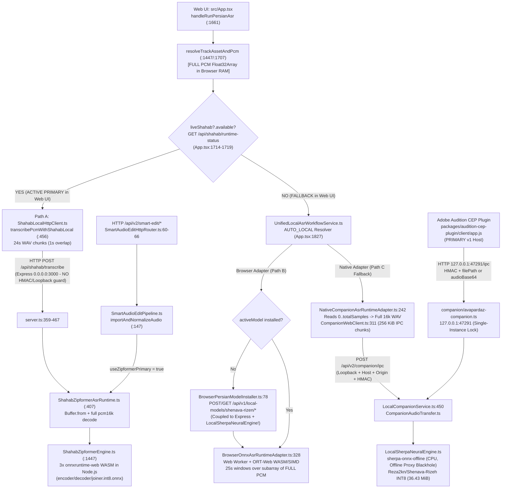

# AVAPARDAZ — AUTHORITATIVE PROJECT STATE (PHASE 0 AUDIT)

**Document ID:** `AVP-AUTH-STATE-0.1`  
**Audit Date:** `2026-11-23`  
**Audit Scope:** Phase 0 — Read-Only Architectural, Execution-Path, Memory, Model, Dataset & Security Baseline Audit  
**Authority:** این سند **تنها مرجع معتبر و واحد (Single Source of Truth)** برای وضعیت واقعی کد، مسیرهای اجرایی ASR، مصرف حافظه، مدل‌ها، دیتاست، امنیت و نقشه راه آواپرداز است. تمام اسناد تاریخی دیگر (از جمله `docs/AVAPARDAZ/CURRENT-STATE.md` و `docs/AVAPARDAZ/IMPLEMENTATION-LEDGER.md`) در صورت هرگونه تعارض باید تابع این سند باشند.  
**Epistemic Tagging Legend:**
- `[Observed Fact]`: مستقیماً از فایل‌های مخزن، اجرای دستور خواندنی یا خروجی ثبت‌شده روی دیسک مشاهده شده است.
- `[Inference]`: نتیجه‌گیری فنی مستقیم از شواهد مشاهده‌شده در کد است.
- `[Assumption]`: فرضی که در این محیط به‌صورت تجربی اثبات نشده است.
- `[Unknown]`: اطلاعات کافی یا محیط اجرایی لازم برای تأیید در دسترس نیست.

---

## ۱. هویت و محدودهٔ محصول

- **نام و ماهیت محصول:** آواپرداز (**AVAPARDAZ**) یک سامانهٔ تدوین گفتار و صوت با پردازش محلی (Local-First / Offline-Verified) با تمرکز بر زبان فارسی و پشتیبانی از انگلیسی است (`[Observed Fact]` — `package.json`, `metadata.json`, `src/runtime/LocalExecutionPolicy.ts`).
- **معماری سه‌موتورهٔ هسته:** جریان پردازش بر پایهٔ سه موتور تخصصی تفکیک‌شده تعریف شده است (`[Observed Fact]` — `docs/AVAPARDAZ/ENGINE-INTERFACE-SPEC.md`, `src/workflow/SmartAudioEditPipeline.ts`):
  1. **Engine 01 — SHAHAB:** تشخیص گفتار محلی (ASR) و تولید Transcript با سیاست منع جعل متن یا Timestamp.
  2. **Engine 02 — Smart Speech Editing:** تحلیل گفتار، تشخیص مکث/تپق/تکرار، تولید EDL و دروازهٔ تأیید انسانی (Human Approval Gate).
  3. **Engine 03 — Precision Audio Renderer:** رندر صوتی با دقت نمونه‌ای (Integer Sample Index)، حفظ کانال‌ها و خروجی WAV.
- **قفل محدودهٔ نسخهٔ ۱ (`v1 Product Scope Lock`):**
  - **محدودهٔ رسمی v1 (اولویت اول انتشار):**
    1. افزونهٔ **Adobe Audition CEP** (`packages/audition-cep-plugin/`).
    2. سرویس **Native Companion (CPU-first)** روی Loopback (`companion/avapardaz-companion.ts`, `LocalCompanionService.ts`).
    3. هستهٔ مشترک پردازش محلی (**Engine 01 — SHAHAB** + **Engine 02 — Smart Speech Editing** + **Engine 03 — Precision Audio Renderer**).
  - **موارد معوق به پس از v1 (Deferred Post-v1):**
    1. توزیع مدل وب از طریق CDN استاتیک (حذف وابستگی Provisioning مرورگر به Express و `LocalSherpaNeuralEngine`).
    2. توسعهٔ Web Studio مستقل از Companion به‌عنوان محصول ثانویه.
  - **تفکیک زیرساخت مشترک در برابر زیرساخت مستقل:**
    - *مشترک بین v1 و مسیر وب آینده:* `AudioSourceHandle`، `UnifiedLocalAsrRuntime` (`LocalAsrRuntimeAdapter`)، موتورهای Engine 02/03، نرمال‌سازی فارسی (`AVP-P0-009/010/012`) و `CanonicalProjectWorkflowEngine`.
    - *مستقل و قابل تکامل جداگانه:* لایهٔ Storage/Provisioning مرورگر (OPFS + CDN Manifest) و رابط کاربری Web Studio در برابر لایهٔ Native Disk/Companion IPC و ExtendScript host (`auditionHost.jsx`).

---

## ۲. وضعیت واقعی مخزن و Commit

- **مسیر واقعی مخزن روی دیسک:** `/app/applet` (`[Observed Fact]`).
- **وضعیت `.git`:** پوشهٔ `.git` در این محیط **وجود ندارد**؛ اجرای `git status --short && git log -n 5 --oneline` با کد خروجی `128` (`fatal: not a git repository`) شکست خورد (`[Observed Fact]`).
- **نام Branch فعلی:** `[Unknown]` — به دلیل نبود `.git`، امکان تأیید شاخهٔ `main` در این محیط وجود ندارد.
- **SHA دقیق آخرین Commit:** `[Unknown]` — هرچند سند مرجع خارجی (`AVAPARDAZ REBUILD 2.1`) به `53443caef656db4bc6e57edad7927ee8106067ca` اشاره کرده است، صحت این SHA، تاریخچهٔ Git و وضعیت Check Runهای GitHub Actions در این محیط قابل تأیید مستقیم نیست (`[Unknown]`).
- **وضعیت Working Tree:** در شروع ممیزی فاز صفر هیچ فایل تولیدی تغییر داده نشده و در طول فاز صفر نیز **صفر** فایل تولیدی تغییر یافته است؛ تنها فایل‌های مستندات تحت `docs/AVAPARDAZ/` ایجاد/به‌روزرسانی شده‌اند (`[Observed Fact]`).
- **مانیفست و مدیر بسته:**
  - `package.json`: `"name": "react-example"`، `"version": "0.0.0"` (`[Observed Fact]`).
  - فایل قفل موجود روی دیسک: `bun.lock` موجود است و `package-lock.json` وجود ندارد (`[Observed Fact]`).
- **فایل‌های مدل روی دیسک (وضعیت فعلی در `2026-11-24` — به‌روزرسانی ممیزی V7.2):**
  - **[Observed Fact — 2026-11-24]:** برخلاف اسنپ‌شات تاریخی `2026-11-23`، در فضای کاری فعلی `/app/applet` فایل‌های باینری ONNX (`encoder.int8.onnx`, `decoder.int8.onnx`, `joiner.int8.onnx`) و `sample.wav` در مسیر `models/persian-zipformer-transducer/1.0.0/` **روی دیسک موجود نیستند** (`0` فایل `.onnx` در کل مخزن). تنها متادیتا/فایل‌های متنی (`manifest.json`, `tokens.txt`, `LICENSE`, `NOTICE`, `transcribe.py`) موجودند؛ بنابراین تست ۳ در `src/shahab/ShahabZipformerAsrRuntime.test.ts` به‌صورت محیطی مسدود (`MISSING_MODEL_ASSET`) و آمادهٔ انتشار نبودن SHAHAB (`NOT_READY`) تا زمان تأمین وزن‌های امضاشده و ارزیابی WER واقعی فارسی پابرجاست.
  - *(یادداشت تاریخی `2026-11-23`: در اسنپ‌شات پیشین، فایل‌های `encoder.int8.onnx` به حجم `113,609,320 B`، `decoder.int8.onnx` به حجم `1,736,806 B`، `joiner.int8.onnx` به حجم `398,795 B` و `sample.wav` ثبت شده بودند؛ هش‌های SHA-256 مورد انتظار در کد بدون تغییر حفظ شده‌اند.)*
  - مسیر `models/shahab-variants/persian-zipformer-int8-cleaned/` فقط شامل `LICENSE`, `NOTICE`, `tokens.txt` است و وزن ONNX ندارد (`[Observed Fact]`).
- **به‌روزرسانی امنیتی و مهندسی V7.2 (`2026-11-24` — `[Observed Fact]`):**
  - بایند سرور Express اکنون از طریق `resolveServerBindHost` در حالت `local` روی `127.0.0.1` و در حالت `hosted` (پیش‌فرض تولید، Fail-Closed) روی `0.0.0.0` انجام می‌شود؛ مسیرهای `/api/shahab/transcribe`، `/api/v2/smart-edit/*`، `/api/shahab/{state,memory,operations/*}`، `/api/v1/asr-core/{batch,benchmark}`، `/api/v1/processing/{execute,trace}`، `/api/v1/asr/{transcriptions,checkpoints/rollback}` و `/api/v1/continuous-learning/feedback` همگی تحت `AudioApiSecurityGuard` (احراز هویت Bearer، Scope، محافظت Replay و محدودسازی نرخ) قرار گرفته‌اند.
  - بای‌پس `X-Forwarded-Host` در `AudioApiSecurityGuard` بسته شد (صرفاً هاست‌های موجود در `trustedProxyHosts` یا Loopback معتبرند).
  - Resampler خطی در کلاینت شهاب (`ShahabLocalHttpClient.ts`) و موتور شهاب (`ShahabZipformerEngine.ts`) با `resampleTo16kMono` ضد-آلیاسینگ (Kaiser-windowed sinc) جایگزین شد، تولید مصنوعی `confidence = 0.85` و برچسب‌گذاری نادرست `AcousticSnap` حذف شد، `decodeWavToMono16k` از `RF64`/`WAVE_FORMAT_EXTENSIBLE (0xFFFE)` پشتیبانی کرده و فایل WAV بریده‌شده را رد می‌کند، `verifyWeightImmutability` به‌صورت چانک ۱ مگابایتی هش می‌گیرد، اسکن `NaN/Infinity` کامل شد، کدگشایی مضاعف WAV/FFmpeg در `SmartAudioEditPipeline` حذف گردید و پاک‌سازی فایل‌های موقت یتیم در راه‌اندازی سرور اضافه شد.
- **مستندات اصلی موجود در مخزن (`docs/AVAPARDAZ/` و `docs/phase-02/`):**
  - بیش از ۶۰ سند در `docs/AVAPARDAZ/` (از جمله `CURRENT-STATE.md`, `IMPLEMENTATION-LEDGER.md`, `MASTER-ROADMAP.md`, `DECISION-LOG.md`, `ENGINE-INTERFACE-SPEC.md`, `MEMORY-ALLOCATION-MAP.md`, `release-acceptance-manifest.json`, `security-acceptance-register.json`) و ۲۱ سند در `docs/phase-02/` (از جمله `RECOVERY-003-ACCEPTANCE-GAP.md`) وجود دارند (`[Observed Fact]`).
  - سه فایل Workflow در `.github/workflows/` موجود است: `avapardaz-quality-gates.yml`, `avp-engine02-03-handoff-import.yml`, `ci-quality-gate.yml` (`[Observed Fact]`).
- **دستورهای معتبر در `package.json` (`[Observed Fact]`):**
  - Typecheck: `npm run lint` (`tsc --noEmit`)
  - Build: `npm run build` (`vite build`)
  - Unit / Test Suites: `npm run test:unit`, `npx vitest run`, `npm run test:quality-gates`, `npm run test:e2e`, `npm run verify:foundation`.

---

## ۳. معماری فعلی سیستم و نقشهٔ مالکیت Workflow

در کدبیس فعلی، لایهٔ Workflow میان چندین هماهنگ‌کننده تقسیم شده است (`[Observed Fact]` — `src/workflow/` و `src/App.tsx`):

| مؤلفه | فایل | نقش واقعی مشاهده‌شده در کد | مالکیت وضعیت |
| :--- | :--- | :--- | :--- |
| رابط کاربری وب | `src/App.tsx` | نگهداری State پروژه (`project.pcmSources`)، اجرای مستقیم مسیر Shahab HTTP یا `UnifiedLocalAsrWorkflowService`، تاریخچهٔ Undo (`historyRef`) و ذخیره در `StorageBrokerClient` | مالک وضعیت جلسهٔ وب (`[Observed Fact]`) |
| هماهنگ‌کنندهٔ ASR محلی | `src/workflow/UnifiedLocalAsrWorkflowService.ts` | انتخاب بین `BrowserOnnxAsrRuntimeAdapter` و `NativeCompanionAsrRuntimeAdapter` بر اساس سیاست `AUTO_LOCAL` | فقط هماهنگ‌کنندهٔ استنتاج محلی (`[Observed Fact]`) |
| پایپلاین تدوین هوشمند سرور | `src/workflow/SmartAudioEditPipeline.ts` | ورود فایل صوتی، اجرای ASR (با اولویت `ShahabZipformerAsrRuntime` در `SmartAudioEditHttpRouter.ts:60–66`)، تحلیل Engine 02، تولید EDL و رندر Engine 03 | مالک اجرای پایپلاین سرور (`[Observed Fact]`) |
| مدیر Job تدوین هوشمند | `src/workflow/SmartAudioEditJobManager.ts` + `SmartAudioEditHttpRouter.ts` | نگهداری نگاشت `jobs` در RAM، مدیریت Abort، ذخیرهٔ `ImportedAudioContext`, `lastPreviewWav`, `lastOutputWav` و عرضهٔ `/api/v2/smart-edit/*` | مالک مستقل Job در Express (`[Observed Fact]`) |
| سرویس Companion | `src/host-bridge/companion/LocalCompanionService.ts` + `companion/avapardaz-companion.ts` | اجرای `LocalSherpaNeuralEngine`، صف Jobهای `JOB_SUBMIT`/`JOB_STATUS`/`JOB_RECONNECT` با احراز هویت HMAC برای CEP و وب | مالک مستقل Job در Companion (`[Observed Fact]`) |
| موتورهای جریان کار دیگر | `src/workflow/CanonicalProjectWorkflowEngine.ts` و `src/workflow/StudioWorkflowController.ts` | پیاده‌سازی‌های تست‌شدهٔ مدل Canonical Project و Studio Controller | به‌صورت یکپارچه به عنوان تنها مالک Job در کل مسیرهای اجرایی متصل نشده‌اند (`[Observed Fact]`) |

**تعارض معماری مشاهده‌شده (`[Inference]`):** وضعیت Job، مالکیت صوت (`pcmSources` در برابر `ImportedAudioContext` در برابر `CompanionAudioTransfer`) و مسیر ASR در سه مسیر موازی مدیریت می‌شوند. در فازهای بعدی، یک **Canonical Project/Job Orchestrator** واحد باید مالکیت Job، Source Handle، Transcript، EDL و Approval را یکپارچه کند، بدون آنکه آداپتورهای Runtime (`BrowserOnnxAsrRuntimeAdapter`, `NativeCompanionAsrRuntimeAdapter`) یا موتورهای سه‌گانه حذف شوند.

---

## ۴. مسیرهای واقعی ASR و Call Graph کامل

در مخزن **۳ مسیر واقعی و فعال/قابل‌فراخوانی** برای تبدیل گفتار به متن شناسایی شد (`[Observed Fact]`):

1. **مسیر A — Shahab / Zipformer (`ACTIVE PRIMARY PATH` در `App.tsx` و `SmartAudioEditHttpRouter.ts`)**
2. **مسیر B — Browser ONNX (`FALLBACK` در `App.tsx` فقط وقتی `liveShahab?.available` نادرست باشد)**
3. **مسیر C — Native Companion / `LocalSherpaNeuralEngine` (`PRIMARY` در افزونهٔ Adobe Audition CEP؛ `FALLBACK/SECONDARY` در `App.tsx` از طریق `UnifiedLocalAsrWorkflowService`)**

### ۴.۱. تحلیل دقیق مسیر A: Shahab / Zipformer (`[Observed Fact]`)

1. **`handleRunPersianAsr` (`src/App.tsx:1661`):** ابتدا `resolveTrackAssetAndPcm(primaryTrack)` (`App.tsx:1707`) را صدا می‌زند که **کل PCM ترک** را به‌صورت یک `Float32Array` پیوسته در RAM مرورگر می‌سازد.
2. **نقطهٔ بررسی `liveShahab?.available` (`src/App.tsx:1714–1719`):** بلافاصله پس از دریافت PCM کامل، `liveShahab = shahabRuntimeStatus ?? (await fetchShahabRuntimeStatus())` (`GET /api/shahab/runtime-status`) بررسی می‌شود.
3. **تقدم بر Browser و Native (`src/App.tsx:1719–1797` در برابر `1827–1835`):** بله — پیش از آنکه `BrowserOnnxAsrRuntimeAdapter` یا `NativeCompanionAsrRuntimeAdapter` حتی نمونه‌سازی شوند، در صورت `liveShahab?.available === true` مسیر `transcribePcmWithShahabLocal` (`App.tsx:1733`) اجرا و تابع پس از آن `return` می‌کند. همین تابع در دکمهٔ نمونه صوتی (`handleLoadAndTranscribeSamplePersianAudio` در `App.tsx:2118`) نیز مستقیماً صدا زده می‌شود.
4. **اندازهٔ تبدیل PCM به WAV (`src/asr-core/ShahabLocalHttpClient.ts` و `ShahabChunkMerger.ts`):** اگر طول صوت `<= 25s` باشد یک WAV کامل 16 kHz Mono PCM16 (با Resampler ضد-آلیاسینگ `resampleTo16kMono`) می‌سازد؛ برای فایل‌های بلندتر، `planAudioChunks` صوت را به پنجره‌های `24s` (`DEFAULT_SHAHAB_CHUNK_SEC = 24`) با همپوشانی `1.0s` (`DEFAULT_SHAHAB_OVERLAP_SEC = 1.0`) تقسیم کرده و هر چانک را به WAV حدود `768 KB` تبدیل می‌کند.
5. **کانال انتقال داده از Browser به Express:** درخواست HTTP `POST /api/shahab/transcribe` با بدنهٔ باینری خام `Content-Type: audio/wav` و هدرهای `Authorization: Bearer ...`، `X-Request-Nonce` و `X-Request-Timestamp` از طریق `fetch`.
6. **Interface و پورت شنود Express (`server.ts`):** سرور با `resolveServerBindHost` در حالت `local` روی `127.0.0.1` و در حالت `hosted` روی `0.0.0.0` (پیش‌فرض پورت `3000`) گوش می‌دهد.
7. **آیا واقعاً Loopback و محافظت‌شده است؟** **بله در حالت `local` (`[Observed Fact]` — پس از سخت‌سازی فاز 1A و V7.2):** `AudioApiSecurityGuard` اتصال Loopback، هدر Host/Origin (بدون اعتماد به `X-Forwarded-Host` غیرمجاز)، توکن موقت نشست محلی و محافظت Replay را روی `/api/shahab/*` و `/api/v2/smart-edit/*` اعمال می‌کند.
8. **نحوهٔ بارگذاری مدل در `ShahabZipformerEngine` (`src/shahab/ShahabZipformerEngine.ts`):** صحت SHA-256 وزن‌ها به‌صورت چانک ۱ مگابایتی (`verifyWeightImmutability`) بررسی و سپس سه نشست `onnxruntime-web@1.31.1` با Execution Provider از نوع `wasm` درون فرآیند Node.js ساخته می‌شود (در محیط فعلی به دلیل نبود فایل‌های `.onnx` روی دیسک، `available = false` گزارش می‌شود).
9. **ورود کامل فایل‌های ONNX به RAM:** **بله هنگام بارگذاری نشست ORT (`[Observed Fact]`):** در صورت وجود فایل‌ها، نشست‌های ORT/WASM کل وزن‌ها را در حافظه خطی WASM بارگذاری می‌کنند (در بنچمارک ثبت‌شدهٔ تاریخی `SHAHAB_BENCHMARK_SUMMARY.json`، `peakRamBytes = 762,404,864 B` ≈ `727.09 MiB` گزارش شده بود).
10. **داده‌های نگهداری‌شده یا آزادشده پس از اتمام Transcription:**
    - نشست‌های ONNX (`encoderSession`, `decoderSession`, `joinerSession`) در `ShahabZipformerAsrRuntime.adapter` **مقیم (Resident)** می‌مانند مگر اینکه `request.unloadAfterTranscribe === true` باشد یا `unloadModel()`/`dispose()` فراخوانی شود (`[Observed Fact]`).
    - `SHAHABMemoryGovernor` (`ShahabZipformerEngine.ts`) کش‌های LRU زیر را با تفکیک `tenantScope` (`ownerId:projectId`) نگه می‌دارد: `featureCache` تا `16 MiB`، `encoderCache` تا `32 MiB`، `streamingCache` تا `8 MiB` (جمع سقف کش `56 MiB`).
    - در پایان `transcribe()` مقدار `this.activeJobId = null` می‌شود و آرایه‌های موقت چانک به GC سپرده می‌شوند.

### ۴.۲. تحلیل دقیق مسیر B: Browser ONNX (`[Observed Fact]`)

- **انتخاب Runtime:** در `src/App.tsx:1827–1842` (فقط در صورت عدم دسترسی به مسیر A)، `BrowserOnnxAsrRuntimeAdapter` و `NativeCompanionAsrRuntimeAdapter` به `UnifiedLocalAsrWorkflowService` با سیاست `preference: 'AUTO_LOCAL'` سپرده می‌شوند.
- **بررسی نصب و دریافت مدل (`App.tsx:1844–1899` و `src/lifecycle/BrowserPersianModelInstaller.ts:78–280`):** اگر `activeModel` نصب نباشد و Companion در دسترس نباشد، `installShenavaRizehInBrowser` صدا زده می‌شود که به `POST /api/v1/local-models/shenava-rizen/prepare` (`server.ts:553`) و `GET /api/v1/local-models/shenava-rizen/artifacts/:filename` (`server.ts:585`) متصل می‌شود. **نکتهٔ بحرانی:** هر دو Endpoint سرور مستقیماً `localCompanionService.neuralEngine.ensureShenavaRizehModelArtifacts()` (`server.ts:555, 597`) را اجرا می‌کنند؛ بنابراین استنتاج مرورگر مستقل از Companion است، اما **مسیر Provisioning اولیهٔ مدل مرورگر هنوز به سرور Express و `LocalSherpaNeuralEngine` وابسته است**.
- **بارگذاری مدل، خواندن PCM و اجرای Inference (`src/asr-core/BrowserOnnxAsrRuntimeAdapter.ts:328–520`):** مدل در OPFS/IndexedDB ذخیره و در Web Worker (`StudioAsrWorkerClient`) روی `onnxruntime-web` (WASM/SIMD) بارگذاری می‌شود. `PersianChunkedAsrEngine` صوت را در پنجره‌های `25s` با همپوشانی `3s` از طریق `request.readSourceRange` می‌خواند — **اما** `App.tsx:1910–1931` این Callback را با `pcmData.subarray(safeStart, safeEnd)` روی همان آرایهٔ کاملاً بارگذاری‌شدهٔ `resolved.pcm` تغذیه می‌کند!
- **تبدیل خروجی و مدیریت خطا/پاک‌سازی:** نتایج پنجره‌ها ادغام، نرمال‌سازی (`AVP-P0-009`) و در بلوک `finally` (`App.tsx:2014`) آداپتور مرورگر `dispose()` می‌شود.

### ۴.۳. تحلیل دقیق مسیر C: Native Companion (`[Observed Fact]`)

- **فراخوانی از Adobe Audition CEP (`packages/audition-cep-plugin/client/app.js:12, 190–225, 320–525`):**
  - به `http://127.0.0.1:47291` متصل می‌شود (`companion/avapardaz-companion.ts:18, 45` فقط روی `127.0.0.1:47291` با فایل Lock تک‌نمونه‌ای گوش می‌دهد).
  - ابتدا از ExtendScript (`avpGetActiveDocumentInfo`) مسیر فایل و `sourceIdentity` را می‌گیرد؛ مسیر ترجیحی ارسال `filePath` محلی است و در نبود مسیر، از `FileReader.readAsDataURL` (`app.js:519–525`) و `audioBase64` استفاده می‌کند.
  - ارتباط پس از `/handshake` با توکن Bearer و امضای HMAC روی `/ipc` (`JOB_SUBMIT`, `JOB_STATUS` هر 450ms، `JOB_CANCEL`, `JOB_RECONNECT`, `CAPABILITY_EXECUTE`) انجام می‌شود و قبل از اعمال نتیجه، `SOURCE_CHANGED` بررسی می‌گردد.
- **فراخوانی از مرورگر (`NativeCompanionAsrRuntimeAdapter.ts:242–294` + `CompanionWebClient.ts:311–389`):**
  - آداپتور در `NativeCompanionAsrRuntimeAdapter.ts:242` کل بازهٔ `0..totalSamples` را می‌خواند و `CompanionWebClient.ts:321` کل آن را در RAM مرورگر به WAV 16 kHz تبدیل کرده و سپس به‌صورت Base64 درون‌خطی (`<= 384 KiB`) یا چانک‌های IPC (`256 KiB` در `AUDIO_UPLOAD_INIT`/`CHUNK`) به `/api/v2/companion` (یا `127.0.0.1:47291`) می‌فرستد.
- **اجرای Inference در Companion (`LocalCompanionService.ts:450–620` + `LocalSherpaNeuralEngine.ts`):**
  - `LocalCompanionService.ts` با بررسی Loopback + Host/DNS-Rebinding + Origin (`lines 654–718`) و HMAC (`lines 738–745`) درخواست را می‌پذیرد و با `LocalSherpaNeuralEngine.transcribe` باینری `sherpa-onnx-offline` را با متغیرهای آفلاین سخت‌گیرانه (`HTTP_PROXY=http://127.0.0.1:9`, `HF_HUB_OFFLINE=1`, `shell: false`) اجرا می‌کند.

### ۴.۴. نمودار Call Graph کامل سه مسیر ASR (Mermaid)



**تصمیم معماری برای تعدد مسیرها (`[Inference]`):** نباید ۳ موتور را به‌صورت مصنوعی در یک کلاس واحد ادغام کرد؛ بلکه در فازهای آینده باید `ShahabZipformer` و `LocalSherpaNeuralEngine` و `BrowserOnnxAsrRuntimeAdapter` همگی پشت یک قرارداد واحد (`LocalAsrRuntimeAdapter` + یک Resolver شفاف با اولویت قابل‌پیکربندی) قرار گیرند تا مسیر میان‌بر خارج از قرارداد در `App.tsx:1714–1797` حذف شود و تمام مسیرها از `AudioSourceHandle` پنجره‌ای تغذیه شوند.

---

## ۵. وضعیت سه موتور اصلی (Engine 01 / 02 / 03)

| موتور | اجزای اصلی روی دیسک | وضعیت فنی واقعی (`[Observed Fact]`) | محدودیت/بدهی اثبات‌شده |
| :--- | :--- | :--- | :--- |
| **Engine 01 — SHAHAB (ASR)** | `UnifiedLocalAsrRuntime.ts`, `BrowserOnnxAsrRuntimeAdapter.ts`, `NativeCompanionAsrRuntimeAdapter.ts`, `LocalSherpaNeuralEngine.ts`, `ShahabZipformerEngine.ts`, `ShahabZipformerAsrRuntime.ts`, `PersianLinguisticQualityEngine.ts`, `PersianEvidenceCorrectionEngine.ts` | پیاده‌سازی‌شده و دارای دو موتور عصبی واقعی (`Shenava-Rizeh` و `Zipformer`)؛ `tsc --noEmit` سبز. | دوشاخه‌شدن مسیر در `App.tsx` (تقدم مستقیم Zipformer خارج از Resolver)؛ نبود اندازه‌گیری آکوستیک واقعی `endSec` کلمات در هر دو مدل (`SEGMENT_ESTIMATED` در Zipformer و تخمین `nextStart`/`chunkEndSec` روی گام 80ms در CTC)؛ عدم تأیید علمی نهایی در Phase-02. |
| **Engine 02 — Smart Speech Editing** | `SmartAudioEditPipeline.ts`, `CanonicalProjectWorkflowEngine.ts`, `SmartAudioEditContracts.ts`, تحلیلگرهای تپق/مکث/تکرار و EDL | پیاده‌سازی‌شده با دروازهٔ تأیید انسانی (`Human Approval Gate`) و Hash منبع (`assertSourceAndEdlIntegrity`). | کیفیت برش دقیق کلمات وابسته به دقت `endSec` خروجی Engine 01 است (`RECOVERY-003-ACCEPTANCE-GAP.md` `R03-14`)؛ ورودی آن در `SmartAudioEditPipeline.ts` و `App.tsx:3562` از PCM کامل تغذیه می‌شود. |
| **Engine 03 — Precision Audio Renderer** | `CanonicalAudioDspEngine.ts`, `src/engine/audioPlayback.ts`, `SmartAudioEditPipeline.ts` (`renderAndExport`), `SmartAudioEditJobManager.ts` (`renderFinal`) | دارای رندر بلوکی/جریانی در لایهٔ DSP (`streamExportTimelineToWav`, Kaiser-windowed sinc, PCM16/24/Float32 bit-identical tests). | `SmartAudioEditJobManager.ts:288–295` خروجی جریانی رندر را دوباره کامل به RAM می‌خواند (`lastOutputWav`) و `SmartAudioEditHttpRouter.ts:299, 355` یک `Buffer.from` اضافی می‌سازد؛ `App.tsx:3618` قبل از رندر، `resolveTrackAssetAndPcm` صدا می‌زند. |

---

## ۶. نقشهٔ تخصیص حافظه و نقاط نگهداری PCM کامل

### ۶.۱. فرمول‌های مبنای حافظه (بدون حدس‌زدن)

فرض کنیم یک فایل صوتی دارای $N$ نمونه در هر کانال، $C$ کانال، نرخ نمونه‌برداری $R$ (Hz) و مدت $D = N / R$ ثانیه باشد (`[Observed Fact]` — فرمول ریاضی ساختارهای TypedArray/WAV):
- **Mono Float32 (نرخ اصلی):** $4N$ بایت.
- **Stereo Planar Float32 (نرخ اصلی، $C=2$):** $4NC = 8N$ بایت.
- **WAV PCM16 ($C$ کانال):** $2NC + 44$ بایت.
- **Mono 16 kHz Float32:** $4 \times 16{,}000 \times D = 64{,}000 D$ بایت.
- **Mono 16 kHz PCM16 WAV:** $2 \times 16{,}000 \times D + 44 = 32{,}000 D + 44$ بایت.

**مثال عددی استاندارد برای فایل ۶۰ دقیقه‌ای ($D=3600\text{ s}$) استریو 48 kHz ($N=172{,}800{,}000, C=2$):**
- Mono Float32 @ 48 kHz: **$659.18\text{ MiB}$**
- Stereo Planar Float32 @ 48 kHz: **$1{,}318.36\text{ MiB}$**
- Stereo PCM16 WAV @ 48 kHz: **$659.18\text{ MiB}$**
- Mono 16 kHz Float32: **$219.73\text{ MiB}$**
- Mono 16 kHz PCM16 WAV: **$109.86\text{ MiB}$**

### ۶.۲. جدول جامع نقاط تخصیص، کپی و نگهداری PCM کامل (`[Observed Fact]`)

*تمایز دقیق اصطلاحات:* در جدول زیر، **«نگهداری عمدی (Intentional Retention)»** (مانند Undo Snapshot یا Cache کش‌شده) و **«بافر موقت بزرگ (Transient Full Allocation)»** صراحتاً از **«نشت حافظه (Memory Leak)»** تفکیک شده‌اند.

| # | مسیر | فایل / تابع / خط | نوع داده | عملیات حافظه و نوع نگهداری | فرمول اندازه و نمونه ۶۰ دقیقه استریو 48kHz | مدت نگهداری | ریسک | راهکار آینده |
| :-: | :--- | :--- | :--- | :--- | :--- | :--- | :--- | :--- |
| 1 | Web UI (۷ نقطه فراخوانی) | `src/App.tsx:1447–1468` (`resolveTrackAssetAndPcm`) ← فراخوانی در خطوط `1482`, `1580`, `1707`, `2163`, `2464`, `3562`, `3618` | `Float32Array` (Mono کامل) | `streamReadRange(id, 0, exactSampleCount)` — **تخصیص کامل موقت / مرجع‌شده در State** | $4N$ بایت (۶۰دقیقه 48kHz ≈ **$659.2\text{ MiB}$**) | تا پایان عملیات و آزادسازی GC (یا طول عمر `project.pcmSources`) | **بحرانی (P0):** OOM در تب مرورگر، باطل‌کردن مزیت Storage Broker | حذف `resolveTrackAssetAndPcm` برای فایل‌های بزرگ؛ تزریق `AudioSourceHandle` پنجره‌ای |
| 2 | Web UI Undo History | `src/App.tsx:2297, 2318–2319` (`handleRedactSelectedWords`), `2366, 2388–2389` (`handleApplySpectralWienerDenoise`) + `src/engine/timeline.ts:727–809` (`TimelineHistoryManager`) | Map ارجاعی به `Float32Array` کامل (`beforePcmSources` و `afterPcmSources`) | **نگهداری عمدی بدون سقف بایت (Intentional Unbounded Undo Snapshot)**؛ نه Memory Leak بلکه فاقد Byte Budget (`maxDepth = 100`, سطر `733`) | $(k+1) \times 4N$ برای $k$ ویرایش تخریبی (۳ ویرایش روی ۳۰دقیقه 48kHz ≈ **$1{,}318\text{ MiB}$**) | تا ۱۰۰ تراکنش یا بارگذاری پروژهٔ جدید | **بحرانی (P0):** رشد خطی RAM در ویرایش‌های پی‌درپی | جایگزینی با معماری Command / Differential / Copy-on-Write روی بلوک‌های OPFS با سقف بایت صریح |
| 3 | Web UI Memo Read | `src/App.tsx:2406–2416` (`prosodyAndChaptersReport` `useMemo`) | `Float32Array` | خواندن مستقیم `project.pcmSources[primaryAssetId]` | وابسته به `pcmSources` ($4N$ در صورت موجود بودن) | طول عمر کامپوننت / تغییر وابستگی Memo | **متوسط (P1):** وابستگی پنهان به PCM مقیم در RAM | محاسبهٔ پنجره‌ای/آسنکرون روی `AudioSourceHandle` یا متادیتای استخراج‌شده |
| 4 | Web → Companion Adapter | `src/asr-core/NativeCompanionAsrRuntimeAdapter.ts:242, 254` + `src/host-bridge/companion/CompanionWebClient.ts:311–389` | `Float32Array` + `Uint8Array` WAV کامل | خواندن کامل `readSourceRange(0, totalSamples)` + ساخت WAV کامل 16 kHz در RAM مرورگر پیش از ارسال چانکی (`256 KiB`) — **بافر موقت بزرگ** | $4N + 32{,}000D$ (۶۰دقیقه 48kHz ≈ **$659.2 + 109.9 = 769\text{ MiB}$**) | تا پایان آپلود تمام چانک‌ها و GC | **بالا (P0):** جهش دوگانهٔ RAM در مرورگر پیش از انتقال | Resample و Encode پنجره‌ای هنگام ارسال چانک به Companion |
| 5 | Companion Transfer Staging | `src/host-bridge/companion/CompanionAudioTransfer.ts:385–405` (`consumeTransfer`) | `Buffer` (`rawBytes`) + `Float32Array` + `Uint8Array` (`wavBytes`) | `fs.readFileSync(sess.tempPath)` (سطر `385`)، تبدیل به `Float32Array` (`398`) و ساخت `wavBytes` (`402`) و بازگرداندن هم‌زمان هر دو — **اوج سه‌برابری موقت** | برای `pcm_f32le` با حجم $B$ (سقف `128 MiB`): اوج هم‌زمان $2.5B$ (تا **$320\text{ MiB}$**)؛ برای `pcm_s16le`: $2B$ (تا **$256\text{ MiB}$**) | تا پایان Job و GC | **بالا (P1):** ناکارآمدی حافظه روی سیستم ۸ گیگابایتی | استریم مستقیم از فایل Staging به WAV دیسکی یا خواندن بلوکی توسط موتور |
| 6 | Companion Job Ingest | `src/host-bridge/companion/LocalCompanionService.ts:474, 490` | `Buffer` + رشتهٔ Base64 | مسیر `uploadId`: `fs.readFileSync(staged.tempPath)` (سقف `64 MiB`)؛ مسیر `audioBase64`: JSON + `Buffer.from(..., 'base64')` (~$2.33 \times B$) — **بافر موقت** | تا `64 MiB` باینری + `~85 MiB` رشته Base64 ≈ **$149\text{ MiB}$** | تا پایان اجرای `transcribe` | **متوسط (P1):** محدود به `64 MiB` اما در مسیر Base64 دوبل می‌شود | اولویت مطلق به `filePath` (در CEP) و Staging فایل‌محور (در وب) بدون `readFileSync` کل فایل |
| 7 | SmartAudioEdit Ingest | `src/workflow/SmartAudioEditPipeline.ts:168, 170, 189, 190, 205, 255–267` (`importAndNormalizeAudio`) | `Buffer` (`rawBytes`) + `Float32Array[]` (`renderChannels`) + `Float32Array` (`monoDownmix`, `canonical16kMono`) | `fs.readFileSync`/`Buffer.from` (کپی ۱) + `decodeNativeWavToPlanar` (کپی ۲) + `ingestAudioBufferToCanonical16kMono` (کپی ۳) + نگهداری کامل در `ImportedAudioContext` — **نگهداری عمدی کامل در طول عمر Job** | $B_{\text{file}} + 4NC + 4N + 64{,}000D$ (برای ۶۰دقیقه استریو 48kHz ≈ `659 + 1318 + 659 + 220` ≈ **$2{,}856\text{ MiB}$**؛ در محدودهٔ سقف HTTP 64MiB ≈ **$275\text{ MiB}$** به ازای هر Job!) | تا حذف/Eviction کامل Job در `SmartAudioEditJobManager` | **بحرانی (P0):** چندبرابر شدن RAM به ازای هر Job و ناسازگاری با M2 8GB | تبدیل `ImportedAudioContext` به `AudioSourceHandle` دیسک‌محور + هش جریانی SHA-256 |
| 8 | SmartAudioEdit Job Retention & Eviction Bug | `src/workflow/SmartAudioEditJobManager.ts:29–35, 225, 288–295, 356–367` | `ImportedAudioContext` + `lastPreviewWav` + `lastOutputWav` | `maxRetainedJobs: 8` مبتنی بر تعداد (نه بایت)؛ `renderFinal` خروجی جریانی را با `readRenderArtifactToUint8Array` دوباره کامل به RAM می‌خواند (`292`)؛ باگ در `evictOldestIfNeeded` (`356–367`): اگر قدیمی‌ترین Job فعال باشد `break;` کرده و Jobهای بیکار جدیدتر را تخلیه نمی‌کند (**شبه-نشت / Unbounded Growth Bug تحت بار هم‌زمان**) | تا $8\times$ (یا بیشتر هنگام باگ Eviction) حجم کامل `ImportedAudioContext` + `lastPreviewWav` + `lastOutputWav` | تا بسته شدن سرور یا Eviction ناقص | **بحرانی (P0):** رشد کنترل‌نشدهٔ RSS و نقض سقف `8` Job | تبدیل سقف به Byte-Budget (`retainedBytes` + `activeBytes`)، اصلاح حلقهٔ Eviction، استریم مستقیم Artifact روی دیسک بدون `lastOutputWav` در RAM |
| 9 | SmartAudioEdit HTTP Response Copy | `src/workflow/SmartAudioEditHttpRouter.ts:299, 355` | `Buffer` | `res.send(Buffer.from(preview.wavBytes))` و `res.send(Buffer.from(wav))` — **کپی کامل اضافی** در هر درخواست Preview/Export | $B_{\text{wav}}$ اضافی در هر پاسخ HTTP | طول عمر پاسخ HTTP تا GC | **متوسط (P1):** کپی زائد بافرهای بزرگ | استریم مستقیم فایل خروجی با `fs.createReadStream` یا `Buffer.from(u8.buffer, u8.byteOffset, u8.byteLength)` بدون کپی |
| 10 | Shahab Zipformer Runtime & Engine | `src/shahab/ShahabZipformerAsrRuntime.ts:445, 453, 515` + `src/shahab/ShahabZipformerEngine.ts:1409, 1466–1468, 815–828` | `Buffer` + `Uint8Array` + `Float32Array` (`pcm16k`) + مدل‌های ONNX در WASM + LRU Cache | کپی `Buffer.from` (`445`)، `new Uint8Array(rawBytes)` (`515`)، دیکد کامل `pcm16k`، بارگذاری کامل `115.7 MB` ONNX به RAM/WASM + نگهداری نشست‌های ONNX و کش LRU تا `56 MiB` (`useCache: true`, سطر `621`) | اوج RSS اندازه‌گیری‌شده در بنچمارک: **$727.09\text{ MiB}$** (`762,404,864 B`) برای فایل کوتاه + ~$64{,}000D$ برای `pcm16k` (تا سقف `600s` ≈ `38.4 MiB`) | نشست‌های ONNX و کش LRU مقیم تا `unloadModel()` / `dispose()` | **بالا (P1):** Footprint بالا در کنار باقی سرویس‌ها روی 8GB | بارگذاری تنبل/تخلیهٔ خودکار پس از بیکاری (Idle Unload)، حذف کپی مضاعف بافر ورودی و خواندن پنجره‌ای |
| 11 | Audition CEP Fallback Upload | `packages/audition-cep-plugin/client/app.js:519–525` | `FileReader.readAsDataURL` (`audioBase64`) | در نبود `filePath`، خواندن کامل فایل به‌صورت Base64 در WebView افزونه — **بافر موقت** | $\approx 1.33 B_{\text{file}}$ (رشته UTF-16 در JS ≈ $2.66 B_{\text{file}}$) | تا پایان ارسال `JOB_SUBMIT` | **متوسط (P1):** در مسیر عادی Audition از `filePath` استفاده می‌شود، اما Fallback روی فایل بزرگ سنگین است | اجبار به ذخیره/ارجاع `filePath` یا آپلود چانکی `AUDIO_UPLOAD_CHUNK` در CEP |

### ۶.۳. سیاست پیشنهادی اصلاح Undo History (برای فاز ۱/۲)

برای حذف نگهداری چند نسخهٔ کامل `Float32Array` در `TimelineHistoryManager` (`src/engine/timeline.ts:727–809`):
- **معماری پیشنهادی:** ترکیب **Command-based Non-Destructive Edits** (برای برش/حذف/مکث که فقط EDL و Cut List را تغییر می‌دهند با هزینهٔ چند کیلوبایت) + **Block-level Copy-on-Write (CoW) / Differential Storage** روی دیسک/OPFS برای عملیات تخریبی DSP (مانند Redact و Spectral Denoise)، همراه با **سقف بایت صریح (`maxUndoBytes`)** ثبت‌شده در `MemoryBudgetManager`.

---

## ۷. طراحی قراردادی `AudioSourceHandle` (فاز صفر — صرفاً مستندسازی)

برای حل ریشه‌ای مشکل حافظه بدون ایجاد وابستگی چرخه‌ای، قرارداد استاندارد زیر به‌عنوان مرجع پیاده‌سازی فاز ۱ تصویب و مستند می‌شود (متناسب با نیاز چندکانالهٔ Engine 03 و نیاز Mono 16 kHz موتور Engine 01):

```ts
export interface PlanarAudioChunk {
  readonly sampleRateHz: number;
  readonly channels: number;
  readonly startSample: number;
  readonly sampleCount: number;
  /** Planar channel buffers: channelData.length === channels, each length === sampleCount */
  readonly channelData: readonly Float32Array[];
}

export interface Mono16kAudioChunk {
  readonly sampleRateHz: 16000;
  readonly startSample16k: number;
  readonly sampleCount16k: number;
  /** Exact corresponding source sample interval [sourceStartSample, sourceEndSample) */
  readonly sourceStartSample: number;
  readonly sourceEndSample: number;
  readonly pcm16k: Float32Array;
}

export interface AudioSourceHandle {
  readonly sourceId: string;
  readonly sourceHashSha256: string;
  readonly sampleRateHz: number;
  readonly channels: number;
  readonly totalSamples: number;
  readonly totalSamples16k: number;
  readonly durationSec: number;
  /** Hard per-call safety ceiling (e.g., max 4,800,000 samples per channel) */
  readonly maxRangeSamples: number;

  /** Planar range reader preserving exact channel separation for Engine 03 & DSP */
  readPlanarRange(
    startSample: number,
    sampleCount: number,
    signal?: AbortSignal,
  ): Promise<PlanarAudioChunk>;

  /** Windowed mono 16 kHz reader with deterministic drift-free sample mapping for Engine 01 */
  readRangeMono16k(
    startSample16k: number,
    sampleCount16k: number,
    signal?: AbortSignal,
  ): Promise<Mono16kAudioChunk>;

  /** Idempotent resource release (closes file descriptors / OPFS handles / releases lease) */
  close(): Promise<void>;
}
```

**الزامات اجباری قرارداد `AudioSourceHandle`:**
1. **تفکیک کانال‌ها:** `readPlanarRange` باید آرایه‌های مجزا به ازای هر کانال (`Float32Array[]`) بازگرداند تا Engine 03 هرگز کانال‌های استریو/چندکاناله را به‌اجبار Mono نکند.
2. **سیاست جلوگیری از Drift در Resampling (`readRangeMono16k`):** تبدیل نرخ نمونه‌برداری باید با نگاشت عددی قطعی (`sourceStart = Math.floor(startSample16k * R / 16000)`) و حاشیهٔ فیلتر (Filter Halo / Lookahead-Lookbehind روی Kaiser-windowed sinc) انجام شود تا خطای فاز و Drift تجمعی در فایل‌های ۶۰ تا ۱۲۰ دقیقه‌ای حداکثر `<= 1` نمونه باقی بماند.
3. **سقف مجاز هر فراخوانی (`maxRangeSamples`):** هر درخواست با `sampleCount > maxRangeSamples` باید صراحتاً با خطای قراردادی `AUDIO_RANGE_EXCEEDS_LIMIT` رد شود (جلوگیری از تکرار الگوی `readRange(0, totalSamples)`).
4. **خطاهای بازهٔ نامعتبر:** ورودی‌های غیرصحیح (NaN، منفی، اعشاری، `startSample >= totalSamples` یا `sampleCount <= 0`) باید خطای `INVALID_AUDIO_RANGE` صادر کنند؛ بازه‌ای که فقط از انتهای فایل عبور کند یا باید بریده (Clamp) شده و `sampleCount` واقعی بازگردانده شود یا خطای مشخص بدهد (سیاست یکسان در همهٔ Adapterها).
5. **لغو (Cancellation):** عبور `AbortSignal` تا سطح خوانش فایل/OPFS/Worker؛ در صورت `signal.aborted`، خطای `AUDIO_READ_ABORTED` بلافاصله صادر و بافر موقت آزاد شود.
6. **مالکیت، Backpressure و چرخهٔ حیات:** مصرف‌کننده نباید بافر بازگشتی را پس از اتمام پنجره نگه دارد؛ هر Handle دارای `Lease` مشخص است و `close()` باید Idempotent باشد؛ خواندن پس از `close()` باید خطای `AUDIO_SOURCE_CLOSED` بدهد.
7. **اتصال غیرچرخه‌ای به Resource/Memory Governor:** `AudioSourceHandle` نباید مستقیماً به کلاس مشخص `MemoryBudgetManager` یا `SmartAudioEditJobManager` وابسته شود؛ بلکه یک Callback/Interface سبک (`MemoryLeaseAcquirer`) به پیاده‌سازی‌های Concrete (مانند `DiskWavAudioSourceHandle` یا `OpfsAudioSourceHandle`) تزریق (Dependency Injection) می‌شود تا هیچ وابستگی چرخه‌ای ایجاد نشود.

---

## ۸. وضعیت Native Companion و Adobe Audition CEP

- **وضعیت کد و بسته‌بندی (`[Observed Fact]`):**
  - سرویس مستقل `companion/avapardaz-companion.ts` روی `127.0.0.1:47291` با فایل Lock تک‌نمونه‌ای و حذف Stale PID پیاده‌سازی شده است.
  - `LocalCompanionService.ts` دارای گاردهای Loopback (`isLoopbackRemoteAddress`), Host/DNS-Rebinding (`isAllowedLoopbackHostHeader`), Origin (`isAllowedCompanionOrigin`) و احراز هویت Bearer + HMAC روی `/ipc` است (`lines 654–745`).
  - افزونهٔ Adobe Audition CEP در `packages/audition-cep-plugin/` (شامل `client/app.js` و `host/auditionHost.jsx`) پیاده‌سازی و به بستهٔ `dist-packages/avapardaz-audition-cep-v1.0.0.tar.gz` بسته‌بندی شده است.
- **موارد تأییدنشده (`[Unknown]` / مسدود برای انتشار):**
  - نصب و اجرای واقعی روی macOS (Apple Silicon M2 8GB) و Windows x64 و Adobe Audition 24/25 GUI هنوز انجام نشده است (`BLK-004`).
  - امضای دیجیتال `.zxp` (`ZXPSignCmd`)، `.dmg` (Apple Notarization) و `.msi` (Authenticode) انجام نشده است (`BLK-001`).

---

## ۹. وضعیت Browser Runtime

- **اجزای پیاده‌سازی‌شده (`[Observed Fact]`):**
  - `BrowserOnnxAsrRuntimeAdapter.ts` با `onnxruntime-web@1.31.1`، Web Worker (`StudioAsrWorkerClient`)، WASM/SIMD و ذخیرهٔ مدل در OPFS پیاده‌سازی شده است.
  - `StorageBrokerClient` (`src/engine/storageBroker.ts`) و `MemoryBudgetManager` (`src/runtime/memory/MemoryBudgetManager.ts`) در مخزن موجودند.
- **دو شکاف معماری اثبات‌شده (`[Observed Fact]`):**
  1. در `App.tsx:1714–1797` وقتی سرور محلی Zipformer در دسترس باشد، Browser Runtime عملاً اجرا نمی‌شود؛ و وقتی در مسیر Fallback اجرا شود نیز ورودی آن از `resolved.pcm` کامل (`App.tsx:1707, 1910–1931`) تأمین می‌شود.
  2. نصب اولیهٔ مدل مرورگر (`BrowserPersianModelInstaller.ts`) به دو Route سرور Express (`/api/v1/local-models/shenava-rizen/prepare` و `/artifacts/:filename`) وابسته است که خودشان `localCompanionService.neuralEngine.ensureShenavaRizehModelArtifacts()` را صدا می‌زنند (`server.ts:555, 597`). بنابراین **استقلال کامل وب از سرور/Companion در مرحلهٔ Provisioning هنوز محقق نشده است** (و طبق قفل محدودهٔ v1، انتقال آن به CDN استاتیک به فاز پس از v1 موکول می‌شود).

---

## ۱۰. وضعیت `ShahabZipformer` و مقایسهٔ منصفانه با `Shenava-Rizeh`

### ۱۰.۱. وضعیت واقعی `ShahabZipformerEngine` (`[Observed Fact]`)

- **طبقه‌بندی رسمی وضعیت:** **`Active Production Path`** (مسیر فعال اصلی در UI وب `App.tsx:1714–1797` و در `/api/v2/smart-edit/*` در `SmartAudioEditHttpRouter.ts:62–66` به محض موجود بودن فایل‌های مدل روی دیسک — که هم‌اکنون روی دیسک موجودند).
- **مشخصات فنی مشاهده‌شده:**
  - مدل: `ramin-mahmoodi/persian-zipformer-asr` (معماری RNN-T / Zipformer-Transducer INT8، سه فایل ONNX مجموعاً `115.76 MB` الزامی).
  - Runtime: `onnxruntime-web@1.31.1` با `executionProviders: ['wasm']` درون Node.js (بدون Native ORT C++ و بدون کش حالت استریمینگ انکودر — گراف Offline است).
  - دقت و منابع ثبت‌شده در `docs/shahab/SHAHAB_BENCHMARK_SUMMARY.json`: `WER = 51.92%`، `CER = 25.67%` (Track A) / `27.78%` (Track B)، `RTF = 0.09`، `coldLatencyMs = 1313`، `warmLatencyMs = 952`، `peakRamBytes = 762,404,864 B` (~`727.09 MiB`).
  - گرانولاریتی Timestamp: فریم‌های 40ms BPE که در `ShahabZipformerAsrRuntime.ts:220` به `SEGMENT_ESTIMATED` نگاشت می‌شوند و در `ShahabZipformerEngine.ts:2012, 2026` خروجی `words: []` برمی‌گرداند.
  - بدهی قراردادی: در `ShahabZipformerEngine.ts:2002` فیلد `architecture` به‌دلیل سازگاری Enum به‌صورت `'FASTCONFORMER_CTC'` گزارش می‌شود در حالی که مدل Zipformer-Transducer است.

### ۱۰.۲. وضعیت واقعی `Reza2kn/Shenava-Rizeh` (`[Observed Fact]`)

- **مشخصات فنی مشاهده‌شده:**
  - مدل: FastConformer CTC INT8 با حجم `36.43 MiB` و مجوز `Apache-2.0`.
  - Runtime: اجرای بومی CPU از طریق `sherpa-onnx-offline` در Native Companion و همچنین پشتیبانی ONNX WASM در Browser Runtime.
  - نتایج بنچمارک بازیابی (`benchmarks/phase02/recovery-verification-2026-11-22.json` روی 25 کلیپ Held-out FLEURS FA):
    - Norm WER: **`14.53%`** | Norm CER: **`3.94%`** | RTF: **`0.0359`** (~`27.8×` سریع‌تر از زمان واقعی) | Peak RSS: **`196.31 MiB`**.
    - (برای مقایسه در همان گزارش، `whisper-large-v3-turbo-int8`: WER `25.81%`, CER `7.18%`, RTF `0.8429`, Peak RSS `2,037.02 MiB`.)
  - محدودیت Timestamp (`LocalSherpaNeuralEngine.ts:483–520` و `RECOVERY-003-ACCEPTANCE-GAP.md` `R03-14`): خروجی CTC تنها زمان شروع توکن‌ها را با گام 80ms می‌دهد و `endSec` کلمات از `nextStart` یا `chunkEndSec` تخمین زده می‌شود نه اندازه‌گیری آکوستیک مستقیم؛ از این رو دقت مرزبندی پایان کلمه فارسی برای برش‌های دقیق Engine 02 هنوز اثبات نشده است.

### ۱۰.۳. برنامهٔ آزمون مقایسهٔ منصفانه (Fair Head-to-Head Protocol — بدون حذف پیش‌داورانه)

چون بنچمارک فعلی `Zipformer` (`SHAHAB_BENCHMARK_SUMMARY.json`) و بنچمارک `Shenava-Rizeh` (`recovery-verification-2026-11-22.json`) روی دیتاست و Runtime یکسان اجرا نشده‌اند، هرگونه تصمیم نهایی حذف یا جایگزینی (`Keep / Primary / Fallback / Deprecate`) منوط به اجرای آزمون منصفانه با شرایط کاملاً یکسان است:
- **ورودی یکسان:** دیتاست Held-out واحد (شامل فارسی رسمی + محاوره‌ای + تپق طبیعی + Code-Switching + نویز)، نرخ `16 kHz Mono` یکسان، نرمال‌سازی متن یکسان (`AVP-P0-009`).
- **سخت‌افزار و محیط یکسان:** اجرای آفلاین بدون شبکه روی همان دستگاه CPU (و در گام تأیید نهایی روی macOS M2 8GB).
- **شاخص‌های اجباری مقایسه:** (1) Normalized WER و CER با فاصلهٔ اطمینان 95% Bootstrap، (2) RTF و Cold/Warm Latency، (3) Peak RSS روی فایل‌های کوتاه و پیوستهٔ 30/60 دقیقه‌ای، (4) دقت Timestamp شروع و پایان کلمه در برابر برچسب دستی Praat TextGrid، (5) پایداری در برابر خطا، لغو (`AbortSignal`) و بازیابی پس از Crash.

---

## ۱۱. وضعیت دیتاست و گیت‌های پذیرش Phase-02 (رفع تعارض اسناد)

### ۱۱.۱. تعارض شناسایی‌شده بین اسناد (`[Observed Fact]`)

- اسناد `docs/AVAPARDAZ/CURRENT-STATE.md` (بخش ۱ و ۲، تاریخ `2026-11-20`) و `docs/AVAPARDAZ/IMPLEMENTATION-LEDGER.md` (بخش ۳، تاریخ `2026-11-20`) وضعیت `PHASE-02` را **`ACCEPTED`** (بر اساس 25 کلیپ FLEURS به مدت `277.33s`) ثبت کرده‌اند.
- اما سند جدیدتر و سخت‌گیرانه‌تر `docs/phase-02/RECOVERY-003-ACCEPTANCE-GAP.md` (تاریخ `2026-11-22`) صراحتاً وضعیت نهایی را **`FINAL PHASE-02 STATUS: BLOCKED`** و **`NEXT AUTHORIZED PHASE: NONE`** اعلام کرده است.

### ۱۱.۲. جدول تفکیک‌شدهٔ وضعیت واقعی (حکم مرجع واحد)

بر اساس قاعدهٔ اولویت شواهد جدیدتر و سخت‌گیرانه‌تر، **`PHASE-02` در وضعیت `BLOCKED` است** و پنج بُعد زیر باید همواره از هم تفکیک شوند:

| بُعد ارزیابی | وضعیت واقعی | شواهد و دلیل دقیق |
| :--- | :---: | :--- |
| **۱. وضعیت کد (Code Status)** | `IMPLEMENTED` | موتورهای Engine 01/02/03، Companion IPC، Browser Runtime و CEP پیاده‌سازی شده‌اند (`[Observed Fact]`). |
| **۲. وضعیت تست‌های خودکار (Test Status)** | `PARTIAL / TYPECHECK PASS` | `npm run lint` (`tsc --noEmit`) در `2026-11-23` با `0` خطا پاس شد (`[Observed Fact]`). وضعیت اجرای امروز سایر سوییت‌ها و CI در این فاز صفر اجرا/تأیید نشده (`[Unknown]` از اجرای زنده امروز). |
| **۳. وضعیت دیتاست (Dataset Status)** | **`BLOCKED`** | طبق `RECOVERY-003-ACCEPTANCE-GAP.md` (`2026-11-22`): حجم کل `3.5635 h` (< `6.0 h` مورد نیاز؛ `0.6839 h` dev و `1.8899 h` held-out)، **`0.0 h`** گفتار محاوره‌ای فارسی، **`0.0 h`** تپق طبیعی، **`0.0 h`** Code-Switching طبیعی، و **`0.0`** فایل Praat TextGrid دستی برای ارزیابی مرزبندی کلمه (`[Observed Fact]`). |
| **۴. وضعیت سخت‌افزار M2 8GB (Hardware Status)** | **`BLOCKED / UNTESTED`** | `M2_HARDWARE = NOT_AVAILABLE`؛ هیچ تست واقعی روی macOS Apple Silicon 8GB یا Windows x64 + Adobe Audition 24/25 انجام نشده است (`[Observed Fact]`). |
| **۵. وضعیت انتشار تجاری (Commercial Release Status)** | **`BLOCKED`** | مسدود به دلیل `BLK-001` (امضای کد/نشر)، `BLK-003` (دیتاست چنددامنه‌ای انسانی)، `BLK-004` (سخت‌افزار M2 و Audition Host GUI)، `BLK-005` (`package-lock.json` و ممیزی CVE)، و گپ‌های امنیتی/حافظه‌ای کشف‌شده در همین ممیزی (`[Observed Fact]`). |

---

## ۱۲. وضعیت امنیتی (یافته‌های راستی‌آزمایی‌شده از کد)

تمام موارد زیر به‌صورت مستقیم از کد مشاهده شده‌اند (`[Observed Fact]`):

| شدت | محل دقیق در کد | یافتهٔ امنیتی مشاهده‌شده | وضعیت فعلی پس از Phase 1A و Phase 1A.1 |
| :---: | :--- | :--- | :--- |
| **P0** | `server.ts` + `src/shahab/ShahabHttpRouter.ts` (`/api/shahab/*`) + `src/workflow/SmartAudioEditHttpRouter.ts` (`/api/v2/smart-edit/*`) + `src/security/AudioApiSecurityGuard.ts` + `src/workflow/SmartAudioEditJobManager.ts` | پیش از Phase 1A، Express روی `0.0.0.0:3000` بدون تفکیک Local/Hosted باز بود؛ همچنین در ممیزی خصمانهٔ Phase 1A.1 پنج شکاف شناسایی شد (Proxy DNS-Rebinding با `Host: evil` + `Origin: evil`، جعل `X-Forwarded-Host` در Hosted، نبود ادعای `aud`/`iss` و پذیرش Shared Secret خام بدون IdP، نبود الزام `Origin` صریح روی `/api/local-auth/session`، و Fail-Open در فراخوانی مستقیم `SmartAudioEditJobManager` بدون `ownerId`). | **بسته‌شده در Phase 1A و Phase 1A.1 (`[Observed Fact]`):** تفکیک صریح `Local` و `Hosted`؛ در `Hosted` الزام هویت مستقل کاربر (`AVAPARDAZ_HOSTED_TOKEN_ISSUER` یا `verifyHostedSession`؛ رد Shared Secret خام و Subjectهای عمومی مانند `default`/`shared`؛ اعتبارسنجی `aud`/`iss`/`sub`/`exp`)، رد صریح `ownerId` در Body (`400`) و Header، الزام `requireExplicitOwnerId: true` در `SmartAudioEditJobManager`، ایزوله‌سازی آمار منابع هر کاربر، مسدودسازی DNS-Rebinding حتی در حالت Proxy، و الزام `Origin` معتبر + قابلیت ابطال نشست در `/api/local-auth/session`. |
| **P0** | `src/host-bridge/companion/LocalCompanionService.ts` + `companion/avapardaz-companion.ts` | در حالت `allowSameOriginProxyHost: true` درخواست با هدر `Host` غیرمحلی و `Origin` هم‌نام (`Host: evil` + `Origin: http://evil`) یا `Origin: null` از iframe سندباکس مرورگر می‌توانست از گارد عبور کند؛ همچنین توکن در Query String و محدودهٔ Port کنترل نمی‌شد. | **بسته‌شده در Phase 1A و Phase 1A.1 (`[Observed Fact]`):** الزام قطعی Loopback بودن `req.headers.host` حتی در حالت Proxy، مسدودسازی `Origin: null` همراه با `Sec-Fetch-Site` مرورگر (حفظ کامل سازگاری Adobe Audition CEP)، مسدودسازی توکن در Query String (`400`)، Rate Limit روی `/handshake`، ارتقای آنتروپی `jobId` به ۱۲۸ بیت و اعتبارسنجی بازهٔ پورت. |
| **P0** | `src/asr-core/SafeModelSupplyChain.ts` + `src/asr-core/LocalSherpaNeuralEngine.ts` (`downloadFileWithRedirects`) | پیش از Phase 1A.1، تا ۶ Redirect HTTP را بدون Host Allowlist، بدون الزام HTTPS در مقصد Redirect، بدون مسدودسازی IP خصوصی/Loopback، بدون سقف حجم دانلود (`maxBytes`) و بدون Timeout/Abort دنبال می‌کرد. | **بسته‌شده در Phase 1A.1 (`[Observed Fact]`):** الزام HTTPS-only، Allowlist صریح دامنه (`github.com`, `objects.githubusercontent.com`, `release-assets.githubusercontent.com`)، اعتبارسنجی هر گام Redirect، مسدودسازی IPهای خصوصی/Loopback/Link-Local (مستقیم و DNS با IP Pinning)، حذف هدرهای حساس در تغییر Host، سقف حجم هدر و جریانی (`maxBytes`)، Timeout اتصال و کل، پشتیبانی کامل `AbortSignal`، بررسی SHA-256 و پاک‌سازی فایل `.part` در هر خطا. |
| **P0** | `src/asr-core/SafeModelSupplyChain.ts` + `src/asr-core/LocalSherpaNeuralEngine.ts` (`extractTarBz2Safe` + `activateDirectoryAtomically`) | پیش از Phase 1A.1، با `python3` تابع `tarfile.extractall()` و در Fallback دستور ناامن `tar -xjf` را بدون بررسی Path Traversal، مسدودسازی Symlink/Hardlink/Device، سقف Tar Bomb و بدون فعال‌سازی اتمیک اجرا می‌کرد. | **بسته‌شده در Phase 1A.1 (`[Observed Fact]`):** حذف کامل `extractall()` و حذف کامل Fallback ناامن `tar -xjf` (Fail-Closed با `SAFE_TAR_EXTRACTOR_UNAVAILABLE`)؛ استخراج عضو‌به‌عضو با مسدودسازی مسیر مطلق، `..`، Symlink، Hardlink، فایل‌های خاص/Device/FIFO، خروج از ریشه، تکرار، سقف تعداد فایل و سقف حجم Tar Bomb؛ استخراج در دایرکتوری Staging ایزوله و فعال‌سازی اتمیک (`activateDirectoryAtomically`) با Rollback به نسخهٔ سالم قبلی در صورت خطا. |
| **P1** | `src/lifecycle/LocalModelArtifactHttpRouter.ts` + `server.ts` (`/api/v1/local-models/shenava-rizen/*`) | پیش از Phase 1A.1، هندلر HTTP `Range` بدون سقف اندازهٔ پاسخ در هر درخواست، بدون رد Multi-Range، بدون Rate/Concurrency Limit، بدون قفل Single-Flight روی `ensureShenavaRizehModelArtifacts()` و بدون بررسی سلامت فایل پیش از تحویل عمل می‌کرد. | **بسته‌شده در Phase 1A.1 (`[Observed Fact]`):** تفکیک از APIهای خصوصی صوت کاربر؛ Allowlist مانیفست + محصورسازی `realpath`؛ سقف قطعی `1 MiB` در هر درخواست `Range` (`416 RANGE_TOO_LARGE`)، رد Multi-Range و Range نامعتبر (`416`)، الزام Range برای فایل‌های بزرگ‌تر از `1 MiB` (`416`)، قفل Single-Flight روی `/prepare`، محدودیت نرخ و هم‌زمانی (`429` + `Retry-After`)، بررسی SHA-256 پیش از تحویل، `ETag`/`304`، `Cache-Control: immutable` و بستن Stream در قطع اتصال. |
| **P1** | `package.json` / `bun.lock` | نبود `package-lock.json` موجب خطای `ENOLOCK` در `npm audit` شده است (`BLK-005`). | **باز (`[Observed Fact]`):** نیازمند تولید `package-lock.json` و ممیزی CVE در مرحلهٔ CI/Release. |

---

## ۱۳. وضعیت Build، Typecheck و Test

- **`npm run lint` (`tsc --noEmit`):** در تاریخ `2026-11-23` اجرا شد و با **کد خروجی `0` و صفر خطای TypeScript** موفق بود (`[Observed Fact]`). *(نکته: ادعای قدیمی `CURRENT-STATE.md` سطر ۴۲ مبنی بر خطادار بودن ۸ فایل تست قدیمی Phase-00 در `tsc --noEmit` دیگر صادق نیست.)*
- **`npm run build` (`vite build`)، `npm run test:unit`، `npx vitest run`، `npm run test:quality-gates`، `npm run test:e2e`:** در این نوبت ممیزی فاز صفر اجرا نشدند تا ممیزی سریع و بدون ایجاد عارضهٔ جانبی روی دایرکتوری‌های Build/Artifact باقی بماند؛ بنابراین وضعیت اجرای زندهٔ امروز آن‌ها **`[Unknown]`** ثبت می‌شود (صرفاً گزارش‌های تاریخی `2026-11-20`/`2026-11-21` در اسناد قبلی موجودند و نباید به‌عنوان تأیید امروز تلقی شوند).
- **وضعیت GitHub Actions (`avapardaz-quality-gates.yml`, `ci-quality-gate.yml`):** به دلیل نبود `.git` و نبود دسترسی به API گیت‌هاب در محیط محلی، وضعیت واقعی اجراهای ریموت **`[Unknown]`** است.

---

## ۱۴. بدهی‌های معماری تأییدشده (Verified Architectural Debt)

1. **دوپارگی مسیر ASR در `App.tsx` (`[Observed Fact]`):** مسیر `ShahabLocalHttpClient` (`App.tsx:1714–1797`) خارج از `UnifiedLocalAsrRuntime` اجرا می‌شود و پیش از Resolver اصلی تصمیم می‌گیرد.
2. **تخصیص PCM کامل در ۷ نقطهٔ `App.tsx` و در `SmartAudioEditPipeline.ts` (`[Observed Fact]` — مسیر Companion در Phase 1B اصلاح شد):**
   - **اصلاح‌شده در Phase 1B (`[Observed Fact]`):** در مسیر `Adobe Audition CEP -> CompanionAudioTransfer -> LocalCompanionService`، تمام فراخوانی‌های `fs.readFileSync`، تخصیص کامل `Float32Array` و ساخت کامل WAV در RAM حذف شدند و با `CompanionAudioSource` مبتنی بر فایل، پنجره‌های `<= 256 KiB`، Backpressure واقعی (`drain`)، چرخهٔ عمر ۱۰ مرحله‌ای و پاک‌سازی فایل‌های یتیم جایگزین شدند (`docs/AVAPARDAZ/PHASE-1B-COMPANION-STREAMING-REPORT.md`).
   - **باقی‌مانده برای Phase 1C (`[Observed Fact]`):** لایه‌های سمت وب و پایپ‌لاین ویرایش (`resolveTrackAssetAndPcm` در `App.tsx`، `importAndNormalizeAudio` در `SmartAudioEditPipeline.ts`، `NativeCompanionAsrRuntimeAdapter.ts:242`، و مصرف داخلی `ingestAudioBufferToCanonical16kMono` در `LocalSherpaNeuralEngine.ts:943`) همچنان کل فایل را در RAM بارگذاری می‌کنند.
3. **باگ Eviction و نبود بودجهٔ بایتی در `SmartAudioEditJobManager.ts` (`[Observed Fact]` — حوزهٔ Phase 1C):** سقف ۸ Job مبتنی بر تعداد است و در صورت فعال بودن قدیمی‌ترین Job (`activeAbort !== null`)، حلقهٔ `evictOldestIfNeeded` (`lines 356–367`) متوقف می‌شود.
4. **نگهداری چند کپی کامل PCM در Undo History (`[Observed Fact]` — حوزهٔ Phase 1C):** `TimelineHistoryManager` تا `100` تراکنش را بدون سقف بایتی نگه می‌دارد (`src/engine/timeline.ts:733, 785–786`).
5. **عدم یکپارچگی مالکیت Job (`[Observed Fact]`):** سه مدیر وضعیت جداگانه (`App.tsx`, `SmartAudioEditJobManager`, `LocalCompanionService`) بدون Orchestrator واحد.
6. **وابستگی Provisioning مرورگر به سرور و Companion (`[Observed Fact]`):** `BrowserPersianModelInstaller.ts` از طریق `/api/v1/local-models/shenava-rizen/*` به `LocalSherpaNeuralEngine` متصل است.
7. **عدم دقت اثبات‌شده در `endSec` کلمات (`[Observed Fact]`):** در Zipformer خروجی کلمه‌ای خالی است (`words: []`) و در `Shenava-Rizeh` پایان کلمه از توکن بعدی یا انتهای چانک تخمین زده می‌شود.
8. **ناسازگاری Metadata معماری در `ShahabZipformerEngine.ts:2002` (`[Observed Fact]`):** گزارش `architecture: 'FASTCONFORMER_CTC'` برای مدل Zipformer-Transducer.

---

## ۱۵. ناشناخته‌ها (Unknowns)

هر مورد زیر در این محیط غیرقابل اثبات بوده و صراحتاً **`[Unknown]`** باقی می‌ماند:
1. نام Branch واقعی، SHA دقیق آخرین Commit و تاریخچهٔ Git (به دلیل نبود `.git`).
2. وضعیت واقعی Check Runها و Branch Protection در GitHub.
3. عملکرد واقعی، Peak RSS و دمای CPU روی **macOS Apple Silicon M2 با 8GB RAM** و **Windows x64** (`NOT_RUN` / `HARDWARE_QUALIFICATION_PENDING`).
4. رفتار واقعی افزونهٔ **Adobe Audition CEP** روی Audition 24/25 واقعی (بارگذاری پنل، ExtendScript markers، قفل فایل و تغییر سند فعال).
5. نتیجهٔ مقایسهٔ علمی منصفانهٔ `ShahabZipformer` در برابر `Shenava-Rizeh` روی یک دیتاست Held-out واحد شامل گفتار محاوره‌ای، تپق طبیعی و Code-Switching.
6. دقت واقعی مرزبندی پایان کلمه (`endSec`) در فارسی نسبت به Praat TextGrid دستی.
7. وضعیت فعلی آسیب‌پذیری‌های CVE وابستگی‌ها (به دلیل نبود `package-lock.json`).

---

## ۱۶. اولویت انتشار v1

برای جلوگیری از پراکندگی مهندسی، اولویت مطلق تا انتشار **v1** روی خط محصولی زیر قفل می‌شود:
1. **هدف v1:** بستهٔ **Adobe Audition CEP + Native Companion (CPU-first) + Engine 01 (SHAHAB) + Engine 02 (Smart Speech Editing) + Engine 03 (Precision Audio Renderer)** با قابلیت پردازش مطمئن فایل‌های ۶۰ تا ۱۲۰ دقیقه‌ای روی سخت‌افزارهای 8GB RAM.
2. **معوق به پس از v1:**
   - توزیع مستقل مدل مرورگر از CDN استاتیک (حذف وابستگی Provisioning وب به Express/Companion).
   - گسترش قابلیت‌های مستقل Web Studio فراتر از نگهداری زیرساخت مشترک.

---

## ۱۷. نقشه راه اندازه‌پذیر فاز ۱، فاز ۲، فاز ۳ و فاز معوق Web/CDN

تمام معیارهای پذیرش زیر عددی و قابل آزمون (Pass/Fail) تعریف شده‌اند:

### فاز ۱ — جریانی‌سازی کامل حافظه و سخت‌سازی امنیتی (Memory Streaming & Security Hardening)
- **وضعیت زیرفازهای فاز ۱ تا این لحظه (`2026-11-23`):**
  - **Phase 1A (`COMPLETED & VERIFIED`):** تفکیک صریح `Local` و `Hosted`، سخت‌سازی Loopback/Origin/Host/HMAC روی `/api/shahab/*`, `/api/v2/smart-edit/*` و `/api/v2/companion`.
  - **Phase 1A.1 (`COMPLETED & VERIFIED`):** بستن شکاف‌های احراز هویت Hosted (`aud`/`iss`/`sub`/`exp` و حذف Shared Secret خام)، سخت‌سازی زنجیرهٔ تأمین مدل (`SafeModelSupplyChain.ts`) و سقف `1 MiB` روی Range Endpoint مدل‌ها (`LocalModelArtifactHttpRouter.ts`).
  - **Phase 1B (`VERIFIED_IN_TESTS` / `HARDWARE_QUALIFICATION_PENDING`):** حذف کامل Materialization صوت در مسیر `Adobe Audition CEP -> CompanionAudioTransfer -> LocalCompanionService`، پیاده‌سازی `CompanionAudioSource` مبتنی بر فایل، چرخهٔ عمر ۱۰ مرحله‌ای، حسابداری ۷ دسته بافر (`<= 256 KiB` برای هر بافر و `<= 1 MiB` کل بافرهای زندهٔ هر انتقال)، Backpressure واقعی (`drain`) و بنچمارک ۱۰، ۳۰ و ۶۰ دقیقه (`docs/AVAPARDAZ/PHASE-1B-COMPANION-STREAMING-REPORT.md`).
  - **Phase 1C (`PENDING`):** جریانی‌سازی `SmartAudioEditPipeline.ts`, `SmartAudioEditJobManager.ts` (رفع باگ `evictOldestIfNeeded` و حذف `lastOutputWav` مقیم RAM)، `TimelineHistoryManager` (سقف بایتی Undo) و ۷ نقطهٔ `resolveTrackAssetAndPcm` در `App.tsx`.
- **معیارهای پذیرش عددی فاز ۱:**
  - پردازش پیوستهٔ فایل **۶۰ دقیقه‌ای استریو 48 kHz** در `SmartAudioEditPipeline` + `LocalCompanionService` با **`Peak Process RSS <= 512 MiB`** (بدون مدل Quality) و **`0 B`** رشد حافظهٔ باقیمانده پس از `close()`/`dispose()` در تکرار ۳ باره.
  - اجرای ۱۰ Job متوالی در `SmartAudioEditJobManager` با فعال نگه داشتن Job شماره ۱: `retainedBytes <= configuredByteCap` و تخلیهٔ ۱۰۰٪ Jobهای بیکار (رفع قطعی باگ `evictOldestIfNeeded`).
  - تعداد فراخوانی `readRange(0, totalSamples)` یا `streamReadRange(id, 0, exactSampleCount)` در مسیر ASR و Render: **`0`**.
  - تست‌های امنیتی جدید: **`100%` رد شدن** درخواست غیر-Loopback روی `/api/shahab/transcribe` و `/api/v2/smart-edit/*`، رد شدن Tar-Slip/Symlink/Tar-Bomb در `extractTarBz2Safe`، رد شدن HTTP Redirect خارج از Allowlist در `downloadFileWithRedirects`، و سقف `<= 1 MiB` در هر درخواست Range.
  - `npm run lint`, `npm run build` و تمامی تست‌های واحد/امنیت: **`100% PASS`**.

### فاز ۲ — یکپارچه‌سازی مسیر ASR/Orchestrator و آزمون منصفانهٔ مدل‌ها + تکمیل دیتاست Phase-02
- **دامنه:**
  1. یکپارچه‌سازی مسیر `ShahabZipformer` پشت قرارداد `LocalAsrRuntimeAdapter` و حذف شاخهٔ میان‌بر `App.tsx:1714–1797`؛ اصلاح `architecture` در `ShahabZipformerEngine.ts:2002`.
  2. یکپارچه‌سازی مالکیت Job/Project تحت یک Canonical Orchestrator مشترک برای Native Companion و Web.
  3. تکمیل دیتاست ارزیابی واقعی Phase-02 (حداقل `>= 6.0` ساعت شامل گفتار محاوره‌ای، تپق طبیعی، Code-Switching و حداقل ۵۰ کلیپ با Praat TextGrid دستی).
  4. اجرای پروتکل مقایسهٔ منصفانهٔ `ShahabZipformer` در برابر `Shenava-Rizeh` روی همان دیتاست Held-out و تصمیم‌گیری رسمی دربارهٔ مدل اصلی/پشتیبان v1 و راهکار دقت `endSec` کلمات (مانند Forced Aligner سبک محلی).
- **معیارهای پذیرش عددی فاز ۲:**
  - تعداد مسیرهای ASR خارج از `LocalAsrRuntimeAdapter`: **`0`**.
  - حجم دیتاست معتبر Phase-02: **`>= 6.0` ساعت** (با `>= 1.0 h` محاوره‌ای، `>= 0.5 h` تپق طبیعی، `>= 0.5 h` Code-Switching و TextGrid مرجع برای اندازه‌گیری `endSec`).
  - خطای میانهٔ مرزبندی شروع/پایان کلمه (Median Boundary Error) روی مجموعهٔ TextGrid اندازه‌گیری و گزارش‌شده (هدف برای برش تمیز Engine 02: **`<= 50 ms`** یا ثبت دقیق گپ و fallback امن به مکث آکوستیک).
  - گزارش مقایسهٔ منصفانهٔ `Zipformer` در برابر `Shenava-Rizeh` با فاصلهٔ اطمینان 95% Bootstrap و انتخاب مستند مدل v1.

### فاز ۳ — اعتبارسنجی سخت‌افزار واقعی (M2 8GB / Windows) و آماده‌سازی انتشار v1
- **دامنه:**
  1. اجرای بنچمارک و تست ۶۰ دقیقه‌ای واقعی روی macOS Apple Silicon (M2, 8GB RAM) و Windows x64.
  2. نصب و آزمون کامل E2E افزونهٔ Adobe Audition CEP روی Audition 24/25 واقعی (Import, Markers, Cut/Apply, Source-Change Guard, Cancel/Reconnect).
  3. ایجاد `package-lock.json` و رفع CVEهای Critical/High؛ امضای دیجیتال `.zxp`, `.dmg`, `.msi` و کلیدهای انتشار مدل (`BLK-001`, `BLK-004`, `BLK-005`).
- **معیارهای پذیرش عددی فاز ۳:**
  - اجرای کامل سناریوی ۶۰ دقیقه‌ای روی **M2 8GB** با `Peak RSS <= 1.2 GiB`، **`0` Crash/OOM**، و **`RTF <= 0.15`** در پروفایل Lite.
  - پاس شدن **`100%`** چک‌لیست تست GUI روی Adobe Audition 24/25 (macOS + Windows).
  - `npm audit --audit-level=high`: **`0` آسیب‌پذیری Critical/High** باز؛ امضای معتبر روی تمام بسته‌های نصبی.

### فاز معوق پس از v1 — استقلال کامل وب و توزیع مدل از CDN استاتیک
- **دامنه:** حذف وابستگی `BrowserPersianModelInstaller.ts` به `/api/v1/local-models/shenava-rizen/*` و `LocalSherpaNeuralEngine`؛ انتقال آرتیفکت‌ها و مانیفست امضاشده (Ed25519 + SHA-256) به CDN استاتیک (ایران + جهانی) با دریافت چانکی مقاوم در برابر قطعی و ذخیره مستقیم در OPFS.
- **معیار پذیرش عددی:** نصب و اجرای کامل ASR فارسی در مرورگر بدون هیچ سرور Express/Companion فعال (`0` درخواست به `/api/v1/local-models/*`) با تأیید امضای Ed25519 و SHA-256.

---

## ۱۸. خلاصهٔ وضعیت اجرای فازها (Phase Execution Ledger)

| فاز | تاریخ | وضعیت | گزارش مرجع |
| :--- | :---: | :---: | :--- |
| **Phase 0** — Architectural & Memory Audit | `2026-11-23` | `COMPLETED` | `docs/AVAPARDAZ/AUTHORITATIVE-PROJECT-STATE.md` |
| **Phase 1A** — Security Containment & Local API Hardening | `2026-11-23` | `VERIFIED_IN_TESTS` | `src/security/AudioApiSecurityPhase1A.test.ts` |
| **Phase 1A.1** — Security Closure & Model Supply-Chain Hardening | `2026-11-23` | `VERIFIED_IN_TESTS` | `src/security/Phase1A1SupplyChainAndAuthClosure.test.ts` |
| **Phase 1B** — Native Companion Streaming & Memory Foundation | `2026-11-23` | `VERIFIED_IN_TESTS` / `HARDWARE_QUALIFICATION_PENDING` | `docs/AVAPARDAZ/PHASE-1B-COMPANION-STREAMING-REPORT.md` |


---

## 2026-11-26 Addendum — SHAHAB Engine 01 Koochik / Native Companion Integration

This addendum supersedes only older claims about the current primary Persian model and default Native Companion route; unrelated historical architecture notes remain historical.

- **Primary Persian model:** `Reza2kn/Shenava-Koochik-v1.0-sherpa-onnx` (NeMo FastConformer CTC FP32, Apache-2.0 upstream). The model remains frozen upstream weights, not an AVAPARDAZ fine-tuned checkpoint.
- **Pinned artifacts:** `model.onnx` 458,819,249 bytes, SHA-256 `6a564b5541920ce1c37bbc91d22e4b3a6838648b9b327eb88997e8db1f90950d`; `tokens.txt` 12,236 bytes, SHA-256 `8e192963f6e666dfa5721e5cbd4710bc1ef592460a45f08cefc94b2db16a6954`.
- **Full held-out FLEURS evaluation:** all 871 rows of Google FLEURS `fa_ir/test` completed with zero runtime failures or empty transcripts. Under AVAPARDAZ `FA-RELAXED-V1` plus Persian spoken-number display ITN, corpus WER was 9.9232% and CER 3.6439%; 13,321.86 sec of speech completed in 307.49 sec (RTF 0.02308). This is controlled read speech, not evidence of global state-of-the-art or generalization to conversational/noisy/multi-speaker audio.
- **Default route:** Native Companion/Koochik is the preferred Engine 01 route when available. Browser WASM remains a fallback. The legacy Zipformer route is explicitly experimental and is no longer selected solely because its model assets are present.
- **Long-audio transport:** browser range reads, streaming Kaiser-sinc resampling, bounded WAV chunks and file-backed Companion transfer are implemented. The Native adapter rejects a legacy transport for recordings longer than 30 seconds rather than materializing the entire recording.
- **Sherpa process lifecycle:** persistent offline Python worker is available when the matching Sherpa package is installed; otherwise a single-invocation native CLI batch path loads the model once for a group of bounded chunks. Installer includes the minimal tested native CLI and ONNX Runtime library.
- **Timing limitation:** Koochik's current Sherpa output gives token onset timestamps but no reliable token durations. Therefore the current output is segment-timed. Word-level end-time claims remain blocked pending a real Persian forced aligner and gold boundary data.
- **Verification still outstanding:** 60–120 minute stress tests with measured peak RSS and cancellation/recovery; conversational/noisy/dialect/overlap corpus evaluation; Windows x64 and actual Adobe Audition GUI acceptance; matched head-to-head benchmark against alternative ASR systems.
- Detailed evidence, metrics, protocol and acceptance gates: `docs/shahab/SHAHAB_ENGINE01_AUDIT_AND_FLEURS_EVALUATION_2026-11-26.md`.


---

## ۱۹. حاکمیت وضعیت جاری و رودمپ مصوب ۲۷ نوامبر ۲۰۲۶

**این بخش به‌عنوان الحاقیهٔ جدیدتر، مرجع تفسیر دامنه و هدف انتشار جاری است.** سند حاضر در ۲۳ نوامبر ۲۰۲۶ تهیه شده و بخش‌هایی از آن به roadmap و وضعیت انتشار قبلی اشاره دارند. در ۲۷ نوامبر، مالک محصول تصمیم جدید و صریحی ثبت کرده است؛ از این تاریخ، برای برنامهٔ اجرایی فعلی، سند زیر ملاک است:

- `docs/AVAPARDAZ/DELIVERY-ROADMAP-INTERNAL-2026-11-27.md`
- شناسه: `AVP-DELIVERY-ROADMAP-1.1`
- دامنه: **Adobe Audition CEP + Native Companion + shared Core**
- هدف انتشار: **Internal Release**
- پلتفرم‌های الزامی: **macOS و Windows**
- Web Studio مستقل و مسیر Browser/WASM/OPFS: **Post-v1 / خارج از مسیر بحرانی**
- پرداخت، مجوز تجاری و انتشار عمومی: **خارج از دامنهٔ انتشار داخلی**

### ۱۹.۱. حل تعارض با احکام تاریخی

1. عبارات قدیمی دربارهٔ «Public Commercial Release» در بخش‌های ۱، ۱۱، ۱۶ و ۱۷، سوابق تصمیم و محدودیت انتشار تجاری قبلی هستند؛ آن‌ها به معنی توقف یا ممنوعیت نسخهٔ داخلی مصوب ۲۷ نوامبر نیستند.
2. الزام امضای عمومی/Notarization برای `.dmg`، Authenticode برای `.msi` و امضای عمومی `.zxp` خودکار به شرط انتشار داخلی تبدیل نمی‌شود. مدل اعتماد، نصب و توزیع داخلی باید در R0 تعیین و مستند شود؛ الزامات امنیتی واقعی سیستم‌عامل و سازمان همچنان باید رعایت شوند.
3. گپ دیتاست، نبود شواهد کافی برای word-level alignment، ریسک‌های حافظه و نبود آزمون میزبان واقعی macOS/Windows همچنان یافته‌های فنی معتبرند و با تغییر دامنه حذف نمی‌شوند. اثر هرکدام بر Gateهای R1 تا R7 مطابق رودمپ داخلی ارزیابی می‌شود.
4. وضعیت «Internal Engineering Qualification» در مانیفست تاریخی، به‌تنهایی به معنی عبور از Gateهای رودمپ جدید یا پذیرش محصول روی هر دو سیستم‌عامل نیست. معیارهای جدید و شواهد مستقل آن‌ها حاکم‌اند.
5. این الحاقیه هیچ قابلیت یا Gateای را به `VERIFIED` یا `ACCEPTED` ارتقا نمی‌دهد.

### ۱۹.۲. آخرین وضعیت ممیزی GitHub در R0

- مخزن رسمی: `bijanbijane/Audiocode`، خصوصی، شاخهٔ پیش‌فرض `main`.
- baseline ثبت‌شده در آغاز رودمپ: `e73394f8e00e477f1de0046e04fd233681610563`.
- گزارش جاری R0 در شاخهٔ `docs/r0-baseline-audit-2026-11-27` و PR #6 نگهداری می‌شود؛ PR باز و Draft است و به `main` ادغام نشده است.
- در چند اجرای مستقل روی push به `main` و pull request، Jobهای دو Workflow اصلی و نیز یک Workflow تشخیصی موقت با `runner_id=0`، نام Runner خالی و صفر Step پایان یافته‌اند. این شواهد نشان‌دهندهٔ شکست پیش از تخصیص Runner است؛ علت دقیق در تنظیمات Billing/Actions یا سرویس GitHub هنوز مشخص نشده است.
- Workflow تشخیصی موقت واقعاً trigger شد، اما پیش از اجرای نخستین Step شکست خورد؛ فایل آن بعداً حذف و نبودش در شاخه تأیید شد.
- تا تخصیص Runner و ثبت Step، هیچ نتیجه‌ای برای TypeScript، Unit Test، Build یا سایر commandهای پروژه قابل ادعا نیست.
- شاخهٔ ممیزی فقط مستندات را تغییر داده است؛ کد محصول و Quality Gateها تغییر نکرده‌اند. `main` دست‌نخورده مانده است.

### ۱۹.۳. وضعیت پذیرش

R0 همچنان **IN PROGRESS** است. دامنه و مسیر تحویل مصوب‌اند، اما تعیین دقیق ماتریس Audition/macOS/Windows، مدل اعتماد توزیع داخلی، baseline اجرایی CI و دسترسی به میزبان‌های فیزیکی/مجاز هر دو سیستم‌عامل هنوز برای خروج از R0 لازم‌اند. تا آن زمان، هیچ Gate عبور نکرده است.


---

## ۲۰. R0 / R6 وضعیت جاری پس از تصمیم مالک (2026-11-28)

این بخش، وضعیت اجرایی جدیدتر را به snapshot تاریخی بخش ۱۹ اضافه می‌کند؛ سوابق قبلی حذف نشده‌اند.

### ۲۰.۱. تصمیم مصوب ماتریس میزبان

تصمیم مالک پروژه در 2026-11-28 در ADR-027 ثبت شد:

| Target ID | سیستم‌عامل | معماری | Host |
|---|---|---|---|
| darwin-arm64 | macOS 14/15 | Apple Silicon | Adobe Audition 25.x |
| darwin-x64 | macOS 14/15 | Intel | Adobe Audition 25.x |
| win32-x64 | Windows 11 | x64 | Adobe Audition 25.x |

این تصمیم، ابهام انتخاب ماتریس را حل می‌کند؛ هیچ‌یک از سه target هنوز از نظر runtime واقعی یا Host فیزیکی VERIFIED / ACCEPTED نیست.

### ۲۰.۲. GitHub و شاخه‌ها

- مخزن رسمی: bijanbijane/Audiocode. پاسخ فعلی GitHub API مقدار private=false را برمی‌گرداند؛ بنابراین عبارت «خصوصی» در snapshot قبلی با metadata فعلی API سازگار نیست و باید به‌عنوان مغایرت تاریخی تلقی شود.
- main همچنان روی e73394f8e00e477f1de0046e04fd233681610563 قرار دارد و در این جلسه تغییر نکرد.
- PR #6: شاخه docs/r0-baseline-audit-2026-11-27، OPEN / DRAFT / NOT MERGED؛ head برابر 4632e84f29221d70bf2a308aefb340ae429f731a.
- PR #7: شاخه feat/r6-target-specific-release-packaging، OPEN / DRAFT / NOT MERGED؛ head در آخرین بررسی a31199a2a4352ced2eac6a6b1b70e5018c13c22b؛ به‌صورت stacked روی head PR #6 قرار دارد.
- PR #7 شامل ۱۱ فایل، ۲۷۹ اضافه و ۳۳ حذف در آخرین بررسی بود.

### ۲۰.۳. CI و قابلیت اتکا به شواهد

- چهار Workflow روی head PR #6 یعنی 4632e84... با نتیجه SUCCESS پایان یافتند: AVAPARDAZ Quality Gates، Architecture Governance، Separated Web/API Container Build و Standalone Platform API Readiness.
- برای PR #7 در آخرین بررسی هیچ Check Run یا Workflow Run قابل مشاهده نبود. Workflowهای فعلی pull request را فقط برای target branchهای main/master فیلتر می‌کنند؛ PR #7 به شاخه R0 هدف‌گذاری شده است. بنابراین تست‌های کد جدید NOT TRIGGERED / NOT AVAILABLE هستند، نه PASS.
- GitHub hostname از shell محلی قابل resolve نبود؛ clone و اجرای محلی تست‌ها انجام نشد.
- هیچ native runtime artifact، installer package یا تست واقعی macOS/Windows/Audition در این جلسه تولید یا اجرا نشد.

### ۲۰.۴. پیاده‌سازی هدف‌محور R6

در PR #7:
- scripts/release-targets.mjs منبع واحد سه target مصوب و نام دقیق فایل‌های native Sherpa / ONNX Runtime است.
- بسته‌ساز از target صریح استفاده می‌کند، runtime target mismatch را fail-closed رد می‌کند، نام artifactها را target-specific می‌کند و target/build-host را در manifest ثبت می‌کند.
- Installer تولیدشده OS/CPU اشتباه و Node.js کمتر از 20 را پیش از کپی payload رد می‌کند؛ wrapper ویندوز PowerShell نیز تولید می‌شود.
- metadata موتور Release با سه target مصوب همگام شده و regression tests اضافه شده‌اند.

محدودیت مهم: AVAPARDAZ_SHERPA_RUNTIME_TARGET فقط assertion در زمان build است؛ اثبات رمزنگاری‌شده یا بررسی format/architecture باینری نیست.

### ۲۰.۵. وضعیت واقعی R0

- ماتریس هدف: APPROVED.
- انتخاب سه target در metadata و packager: IMPLEMENTED IN PR #7; CI NOT RUN.
- native runtime payload برای هر سه target: NOT AVAILABLE / NOT QUALIFIED.
- نصب CEP در مسیر واقعی Adobe، ثبت/راه‌اندازی Companion، update/rollback یکپارچه و signature verification: OPEN.
- تست فیزیکی Windows 11 x64، macOS 14/15 Apple Silicon و Intel با Audition 25.x: NOT RUN.
- سیاست داخلی signing/trust و مدل اجرای Companion: OPEN.
- R0 و R6: IN PROGRESS — NOT ACCEPTED.

مراجع:
- DECISION-LOG.md — ADR-027
- HARDWARE-COMPATIBILITY-MATRIX.md — Section 3
- R0-DISTRIBUTION-TRUST-AUDIT-2026-11-28.md — Section 8
- PR #7 — target-specific packaging


### ۲۰.۶. به‌روزرسانی پس از Native Runtime Qualification CI

در commit برابر با 4959fdddb3f3a7205a800e80562de76b282aa2ec:

- ماژول scripts/verify-native-binary.mjs معماری Mach-O و PE را از header واقعی می‌خواند؛ متغیر target به‌تنهایی مبنای اعتماد نیست.
- بسته‌ساز هر دو باینری Sherpa و ONNX Runtime را پیش از کپی بررسی می‌کند و فایل ONNX مفقود را fail-closed رد می‌کند.
- تست synthetic معماری در scripts/verify-native-binary.spec.ts قرار گرفته و در Vitest کشف می‌شود.
- AVAPARDAZ Quality & Release Gates: SUCCESS.
- Architecture Governance, Reliability & Release Quality Gate: SUCCESS.
- Vitest: 26 فایل و 109 تست PASS؛ تست verifier چهار مورد PASS.
- Unit/reliability/fault-injection، End-to-End Quality Gates، Production Build و Release Manifest Verification: PASS.
- CI ابتدا دو ایراد را کشف کرد (nested template literal و type annotation) که پیش از این head اصلاح شدند.

این شواهد، کد parser و تست‌های synthetic را روی runner لینوکس تأیید می‌کند؛ به معنی اجرای Runtimeهای واقعی macOS/Windows یا پذیرش Audition نیست. سه runtime واقعی هنوز تهیه/ساخته و روی میزبان مقصد تأیید نشده‌اند.

وضعیت جاری: **CI PASS ON PR #7 HEAD 4959fdd؛ NATIVE PAYLOAD / PHYSICAL HOST ACCEPTANCE STILL OPEN.**


### ۲۰.۷. شواهد اجرای parser روی سه سیستم‌عامل

در PR #7 head برابر با 52e4eda48e8bd9a37ec61ca24ec8e4e544d330ee، ماتریس اختصاصی parser با موفقیت روی هر سه runner تکمیل شد:

| Runner | معماری واقعی runner | نتیجه |
|---|---|---|
| macos-latest | darwin-arm64 | 5/5 PASS |
| ubuntu-latest | linux-x64 | 5/5 PASS |
| windows-latest | win32-x64 | 5/5 PASS |

هر runner از lockfile ثابت Bun استفاده کرد و پنج تست Mach-O / PE را اجرا کرد. این نتیجه، portability تست و parser را روی این محیط‌ها تأیید می‌کند؛ اثبات native runtime payloadهای محصول یا نصب واقعی روی سه target مصوب نیست.

AVAPARDAZ Quality & Release Gates نیز روی همین head SUCCESS شده است. Architecture Governance workflow در آخرین checkpoint هنوز در حال اجرا بود؛ نتیجه نهایی آن باید جداگانه تأیید شود.


### ۲۰.۸. تأمین و smoke test واقعی Sherpa Runtime برای سه پلتفرم

در PR #7 head برابر با 5d31165ee455f288c8de67baeb8b1c086fc21f62، سه job مستقل Provisioning موفق شدند:

| Target | Hosted runner | باینری/کتابخانه | نتیجه |
|---|---|---|---|
| darwin-arm64 | macOS 15 Apple Silicon | Mach-O arm64، سه dylib | SHA-256 + architecture + `--help`: PASS |
| darwin-x64 | macOS 15 Intel | Mach-O x64، سه dylib | SHA-256 + architecture + `--help`: PASS |
| win32-x64 | Windows Server 2025 x64 | PE x64، دو DLL | SHA-256 + architecture + `--help`: PASS |

سه asset از release رسمی Sherpa-ONNX v2.0.2 دریافت می‌شوند؛ bytes و SHA-256 در NativeReleaseTargets ثبت شده‌اند. Provisioner با SafeModelSupplyChain دانلود و استخراج می‌کند، باینری و تمام shared libraryها را از نظر معماری بررسی می‌کند و سپس executable واقعی را با `--help` اجرا می‌کند. Runtime manifest در مسیر target-specific نوشته می‌شود؛ هیچ باینری به Git commit نشده است.

SafeModelSupplyChain همچنان symlink را به‌صورت پیش‌فرض رد می‌کند. برای assetهای native پین‌شده فقط symlink نسبی در همان پوشه lib materialize می‌شود؛ target باید regular file در همان پوشه باشد. hardlink، path traversal، absolute link و symlink chain رد می‌شوند.

LocalSherpaNeuralEngine نیز برای سه target پشتیبانی provisioning پیدا کرده است؛ Windows DLL discovery و PATH handling و macOS versioned dylib discovery اصلاح شده‌اند.

### ۲۰.۹. محدودیت پذیرش باقی‌مانده

- macOS 14 runnerهای GitHub Actions بازنشسته شده‌اند؛ CI فعلی macOS 15 arm64 و Intel را تست می‌کند.
- Windows smoke روی Windows Server 2025 x64 است، نه Windows 11.
- Full cross-target unsigned Installer + Update package build با production web bundle و مدل Koochik تأییدشده برای هر سه target اجرا شد؛ شش tarball ساخته و SHA-256/byte-length و model/runtime provenance آن‌ها PASS شد. این artifactها منتشر یا امضا نشده‌اند.
- Windows 11 و macOS 14/15 روی میزبان فیزیکی، Adobe Audition 25.x، CEP registration، Companion startup، signing/trust، update و rollback هنوز ACCEPTED نیستند.
- Assertion قدیمی Manifest که مدل را در ریشه packageManifest می‌خواند اصلاح شد تا از `components.primaryPersianAsrModel` استفاده کند. اجرای اصلاح‌شده full package gate را با PASS به پایان رساند.

وضعیت: **Native runtime qualification + hosted cross-target unsigned Installer/Update build and integrity gates PASS. Physical installation, Audition integration, signing/trust and update acceptance remain IN PROGRESS.**


### ۲۰.۱۰. Runtime provenance enforcement و CPU floor

- Target registry اکنون ویژگی CPU لازم را ثبت می‌کند: `NEON` برای Apple Silicon و `AVX2` برای Intel macOS و Windows x64. این metadata در runtime manifest و package manifest ذخیره می‌شود؛ هنوز CPUID enforcement در Installer پیاده‌سازی نشده است.
- مطابق مستندات رسمی Adobe Audition 25.x، AVX2 برای Windows و Intel macOS لازم است؛ Hardware Compatibility Matrix و فایل System Requirements تولیدی با این الزام همگام شدند.
- Package builder بدون `runtime-manifest.json` معتبر ادامه نمی‌دهد؛ target ID، archive hash/bytes، executable hash، ONNX library hash و مجموعه کامل shared-library hashها را تطبیق می‌دهد و manifest را در payload نهایی embed می‌کند.
- `LocalSherpaNeuralEngine` نیز پس از smoke test همین manifest را ثبت و هنگام کشف runtime، hashها و target را بررسی می‌کند.
- دو ایراد single-flight promise cleanup در نصب Runtime و دریافت مدل اصلاح شد؛ قبلاً callback مقدار promise wrapper را با task اصلی مقایسه می‌کرد و cache هرگز پاک نمی‌شد، بنابراین retry پس از settlement ممکن نبود.

Latest fully validated full native/package CI head: `337844e6b0b00228dbd1d6781e3c331c4344c6ee`. Both applicable workflows completed SUCCESS: AVAPARDAZ Quality & Release Gates Levels 1–5; Architecture Governance with Vitest 30 files / 130 tests, Node reliability/fault-injection 32 tests, TypeScript compilation, zero-circular dependency check across 730 files, SBOM, license audit, E2E quality gates, production build, release manifest verification, all four native parser runners, all three native runtime provisioning targets, and the cross-target Installer/Update build with six tarball hash and provenance checks. Current branch head is `54a1da21778dc0dd852840c2b5662104a82c5664`; its AVAPARDAZ Levels 1–5 workflow passed. A subsequent architecture run hit a transient GitHub Artifact Service timeout on macOS arm64 upload after provisioning passed; the failed upload job was retried. This evidence remains specific to commit `337844e` for the full package gate.


---

## ۲۱. R6-WP02 — Native Runtime Qualification و Cross-target Package CI (2026-11-28)

### ۲۱.۱. تغییرات Workflow

- `.github/workflows/ci-quality-gate.yml` در PR #7 با نسخه کامل workflow شاخه پایه همگام شد؛ native binary parser، سه native runtime provisioning job، Koochik provenance و cross-target package build حفظ شدند.
- PR branch filter شامل شاخه stacked پایه شد تا workflow برای PR #7 اجرا شود.
- خطای assertion مربوط به package model provenance اصلاح شد: مدل اصلی زیر `packageManifest.components.primaryPersianAsrModel` قرار دارد، نه root object.
- Job ماتریس تکراری در Workflow دیگر حذف شد تا provisioning مجدد و غیرضروری رخ ندهد.

### ۲۱.۲. شواهد CI روی commit 337844e

| Gate | نتیجه |
|---|---|
| AVAPARDAZ Levels 1–5 | PASS |
| Architecture Governance / TypeScript / circular dependency / SBOM / license | PASS |
| Vitest | 30 files / 130 tests PASS |
| Node reliability / fault-injection | 32 tests PASS |
| Native binary format parser | Ubuntu, macOS 15 arm64, macOS 15 Intel, Windows x64 — PASS |
| Sherpa runtime provisioning | darwin-arm64, darwin-x64, win32-x64 — PASS |
| Koochik immutable revision / SHA-256 / Apache license | PASS |
| Cross-target unsigned Installer + Update build | PASS — شش tarball |
| Tarball bytes + SHA-256 + embedded model/runtime provenance | PASS برای هر سه target |

Artifactهای runtime برای هر سه هدف و artifact نهایی manifest-only با شناسه `15262947641` در GitHub Actions ذخیره شدند. بسته‌های unsigned در CI منتشر نشدند.

### ۲۱.۳. محدودیت‌های باقی‌مانده

- Hosted macOS 15 arm64 و Intel، جایگزین آزمون macOS 14 فیزیکی نیستند.
- Windows Server 2025 x64، جایگزین آزمون Windows 11 فیزیکی نیست.
- Adobe Audition 25.x، CEP registration و Companion lifecycle هنوز روی میزبان واقعی تست نشده‌اند.
- Installer امضا نشده است؛ trust-root pinning، signature verification و update signature enforcement هنوز باز هستند.
- نصب تمیز، repair، upgrade، rollback و uninstall روی میزبان‌های فیزیکی هنوز اجرا نشده‌اند.
- CPUID enforcement برای AVX2 در Installer هنوز پیاده‌سازی نشده است؛ target metadata فقط حداقل CPU را اعلام می‌کند.

### ۲۱.۴. وضعیت Git

- PR #7: OPEN / DRAFT / NOT MERGED.
- Latest branch head در زمان این ثبت: `54a1da21778dc0dd852840c2b5662104a82c5664`.
- `main` بدون تغییر مانده است.
- R6 hosted packaging/integrity gates: **PASS**؛ internal distribution trust و physical acceptance: **OPEN**.
