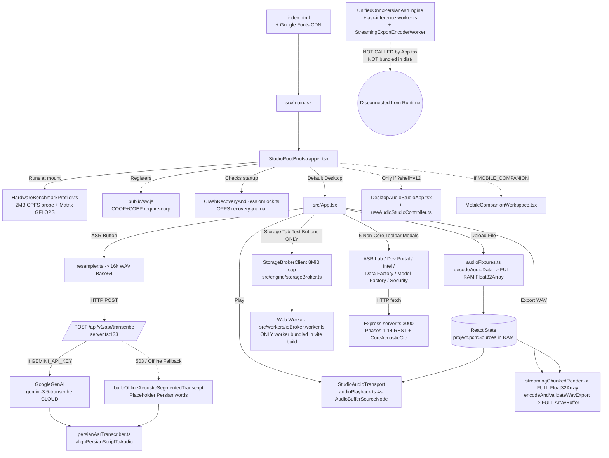

# نقشه وابستگی‌های زمان اجرا (AVP-P00-001 — Runtime Dependency Map)

**مأموریت:** `AVP-P00-001`  
**توضیح:** این سند صرفاً روابط واقعی اجرا (نه صرفاً ایمپورت‌های تستی یا کدهای ایزوله) را با نمودار Mermaid مستندسازی می‌کند `[OBSERVED]`.

---

## ۱. نمودار جریان اجرای واقعی برنامه کنونی (`Mermaid`)

---

## ۲. جدول خلاصه مرزهای اجرایی (`[OBSERVED]`)

| لایه اجرایی | محل اجرا | فایل‌های فعال | وضعیت اتصال در `vite build` |
| --- | --- | --- | --- |
| **Main UI & State** | Browser Main Thread | `main.tsx`, `StudioRootBootstrapper.tsx`, `App.tsx`, `components/*` | باندل کامل (`index-*.js`, `1,282 kB`) |
| **Audio DSP & Timeline** | Browser Main Thread | `dsp.ts`, `timeline.ts`, `resampler.ts`, `peakPyramid.ts`, `processingGraph.ts`, `persianAsrTranscriber.ts` | باندل کامل (همه همگام روی Main Thread) |
| **Worker Storage** | Dedicated Worker | `src/workers/ioBroker.worker.ts` | باندل‌شده (`ioBroker.worker-*.js`) ولی خارج از مسیر Upload/Export |
| **Worker ASR / Export** | Dedicated Workers (طراحی‌شده) | `asr-inference.worker.ts`, `StreamingExportEncoderWorker.ts` | **باندل نشده و غیرمتصل در تولید** |
| **AudioWorklet** | Audio Rendering Thread | `playback.worklet.ts`, `public/asr-stream-worklet.js` | **غیرمتصل به `App.tsx`** |
| **Express Server** | Node.js (`tsx server.ts`) | `server.ts`, `src/asr-core/*`, `src/ai-engine/asr/*`, `src/platform/*`, `@google/genai` | فعال در پورت `3000` (اما `node server.ts` fail می‌شود) |
| **Docker / Postgres Backend** | ایزوله | `backend/*`, `deploy/docker-compose.backend.yml` | **غیرمتصل در اجرای فعلی** (بجز `PlatformLicenseService.ts`) |
